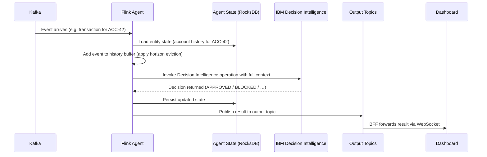

# Event Rules

> **Turn streaming event data into intelligent, real-time decisions — without touching application code.**

[](https://flink.apache.org/)
[](https://kafka.apache.org/)
[](https://www.ibm.com/products/decision-intelligence-client-managed-software)
[](https://openjdk.org/)
[](https://react.dev/)
[](https://www.apache.org/licenses/LICENSE-2.0)

---

## Table of Contents

1. [Introduction](#1-introduction)
2. [Prerequisites](#2-prerequisites)
3. [Quick Start](#3-quick-start)
4. [Architecture Overview](#4-architecture-overview)
5. [Flink Backends](#5-flink-backends)
6. [How Event Rules Work](#6-how-event-rules-work)
7. [Agent Diagram Editor](#7-agent-diagram-editor)
8. [Building and Testing](#8-building-and-testing)
9. [Running with Docker](#9-running-with-docker)
10. [Running Locally](#10-running-locally)
11. [Use Cases](#11-use-cases)
12. [Generating an Event Rules Application with AI](#12-generating-an-event-rule-application-with-ai)
13. [Demo Scenario Isolation](#13-demo-scenario-isolation)
14. [Project Structure](#14-project-structure)
15. [Monitoring and Troubleshooting](#15-monitoring-and-troubleshooting)
16. [Further Reading](#16-further-reading)
17. [License](#17-license)

---

## 1. Introduction

### What does this application do?

Event Rules watches streams of business events in real time — transactions, orders, logins,
account changes — and automatically makes decisions about each one.

For example: when a bank transaction arrives, the application checks it against a set of
fraud-detection rules and immediately classifies it as **APPROVED**, **REQUIRES_VERIFICATION**,
**PENDING_REVIEW**, or **BLOCKED**. It does this continuously, for every event, with low latency
(~100–150 ms end-to-end), and at scale.

### What are Event Rules Agent?

An **Agent** is a stateful processing unit that:

- **Subscribes** to one or more Kafka event streams
- **Remembers** a bounded history of events for each entity it tracks (e.g. all recent
  transactions for a given account)
- **Evaluates** each new event in full context — the new event *plus* everything the Agent
  already knows about that entity

An **Event Rule** is a business rule that decides what to do with an event. Rules are written in
plain business language using IBM Decision Designer, not code. For example:

> *"If more than 5 transactions have arrived in the last 5 minutes for this account, add 35 to
> the risk score."*

Because the Agent holds history, that rule works across events — not just for the single event
currently being processed. This is what distinguishes the Agent model from simple per-event
filtering.

### Why IBM Decision Intelligence?

[IBM Decision Intelligence](https://www.ibm.com/products/decision-intelligence-client-managed-software)
provides a visual authoring environment where business analysts write and manage rules using
decision tables and natural-language sentences — no Java, Python nor SQL required.

Rules are packaged as a **Decision Service Archive** (a JAR file) and loaded directly into the
running application. When rules change, the application automatically picks up the new archive —
**no restart, no rebuild, no code deployment**.

### The core business value

| Traditional Approach                                       | Event Rules Agent                                        |
|--------------------------------------------------------------|--------------------------------------------------------------|
| Business logic baked into application code                 | Logic lives in IBM Decision Intelligence Archives        |
| Rule change = code change + build + test + redeploy (days) | Rule change = table edit + JAR export + `curl` (minutes) |
| Developers own rule changes                                 | Business analysts own rule changes                       |
| System must restart for new logic                          | Live hot-swap via Kafka broadcast state, zero downtime   |
| Single-event evaluation only                                | Full entity history available at every decision          |

---

## 2. Prerequisites

| Tool                     | Version           | Required for                                       |
|----------------------------|--------------------|-------------------------------------------------------|
| Docker & Docker Compose  | 20.10+ / V2+       | Quick Start, running the full stack                |
| Java (JDK)               | 21                 | Building/running the backend outside Docker        |
| Maven                    | 3.6+               | Building the backend                               |
| Node.js & npm            | 20.x / 10.x        | Building/running the frontend and BFF               |
| `jq`                     | any                | Sample and validation scripts                       |
| IBM Decision Designer       | running instance | Resolving IBM Decision Intelligence Maven dependencies (see [§8](#8-building-and-testing)) |

For the full list of runtime environment variables, see [`.env.example`](.env.example) and
[`DOCKER.md`](DOCKER.md).

---

## 3. Quick Start

This walks through the **Banking Fraud Agent** use case — the fastest way to see the application
work end to end.

```bash
# 1. Clone and build
git clone <repo-url>
cd event-rule
./build.sh

# 2. Start all infrastructure services
./run.sh up

# 3. Submit the banking fraud-detection job
./samples/banking-fraud-agent/scripts/deploy.sh

# 4. Open the dashboard
open http://localhost:3010
```

**Expected result:** The React dashboard opens. Click **Agent Banking** in the use-case selector.
Click any scenario button in the **Send Events** panel. A fraud-detection result appears within a
second.

> **Stop everything:** `./run.sh down`
>
> **Full environment reset:** `./run.sh clean` (or `make clean`)

### Services started

| Service          | URL                     | Purpose                              |
|--------------------|---------------------------|-----------------------------------------|
| Kafka            | `localhost:9092`        | Event broker                         |
| Flink JobManager | `http://localhost:8081` | Flink cluster UI + REST API          |
| BFF              | `http://localhost:8080` | Kafka-to-WebSocket bridge + REST API |
| Dashboard        | `http://localhost:3010` | React real-time event monitor        |

See [`samples/banking-fraud-agent/README.md`](samples/banking-fraud-agent/README.md) for the
fraud-detection rules, event shapes, demo scenarios, and a full end-to-end walkthrough of a
decision.

---

## 4. Architecture Overview

The system is composed of four tiers connected through Apache Kafka. The stream-processing tier
has two interchangeable Flink backends, selected at launch time (see
[§5](#5-flink-backends)).

```
┌──────────────────────────────────────────────────────────────────┐
│  PRODUCER TIER                                                    │
│  React Dashboard  /  CLI (kcat)  /  External systems             │
└────────────────────────────┬─────────────────────────────────────┘
                             │  JSON events (REST → BFF → Kafka)
                             ▼
┌──────────────────────────────────────────────────────────────────┐
│  MESSAGE BROKER  —  Apache Kafka + Zookeeper                     │
│  Input:    agent-account-events, …                               │
│  Control:  <agentId>-archive-control  (optional, per agent)      │
│  Output:   agent-fraud-alerts, agent-approved-transactions, …    │
└────────────────────────────┬─────────────────────────────────────┘
                             │  KafkaSource (Flink Connector)
                             ▼
┌──────────────────────────────────────────────────────────────────┐
│  STREAM PROCESSING  —  Apache Flink 2.2.0                        │
│  One agents.json, two interchangeable backends (see §5)          │
│                                                                  │
│  ┌─────────────────────────────┐  ┌────────────────────────────┐ │
│  │ DataStream backend (default)│  │ PTF backend                │ │
│  │ AgentBasedDataStreamJob     │  │ AgentBasedPTFJob           │ │
│  │                             │  │                            │ │
│  │ KafkaSources ─► union       │  │ Kafka sources ─► SQL views │ │
│  │   ─► keyBy(entityId)        │  │   <agent>_in               │ │
│  │ ArchiveControl (broadcast)  │  │ PARTITION BY entity_id     │ │
│  │   ─► StatefulAgentProcessor │  │   ─► StatefulAgentProcess- │ │
│  │      (RocksDB keyed state)  │  │      TableFunction (PTF)   │ │
│  │   ─► filter by eventType    │  │   ─► <agent>_out ─► sinks  │ │
│  │   ─► KafkaSinks             │  │                            │ │
│  │ Chaining: AgentChainBuilder │  │ Chaining: <agent>_out view │ │
│  │ Runs on: Flink cluster      │  │ Runs on: Flink cluster or  │ │
│  │                             │  │ Confluent Cloud for Flink  │ │
│  └──────────────┬──────────────┘  └─────────────┬──────────────┘ │
│                 └───────────────┬───────────────┘                │
│  Shared: decision logic, IBM Decision Intelligence DecisionRunner│
│  (in-process), Kafka I/O, EXACTLY_ONCE checkpoints every 60 s    │
└────────────────────────────┬─────────────────────────────────────┘
                             │  Output Kafka topics
                             ▼
┌──────────────────────────────────────────────────────────────────┐
│  PRESENTATION TIER                                               │
│  BFF (Node.js/Express :8080)    React Dashboard (nginx :3010)    │
│  Kafka consumer → WebSocket     WebSocket client + axios REST    │
└──────────────────────────────────────────────────────────────────┘
```

### Key technical decisions

| Decision                           | Rationale                                                                                                                    |
|---------------------------------------|-----------------------------------------------------------------------------------------------------------------------------------|
| **Apache Flink**                   | Native RocksDB keyed state, exactly-once checkpointing, broadcast state API maps perfectly to zero-downtime archive reload   |
| **Two Flink backends**             | DataStream (default, hot reload, SQL enrichment) and Process Table Functions (SQL-based, can run on Confluent Cloud for Apache Flink); same `agents.json` |
| **IBM Decision Intelligence in-process** | ~8 ms rule execution with no network hop; each archive version gets its own `URLClassLoader` for isolation              |
| **Kafka broadcast state**          | Ordered, exactly-once delivery of archive-control commands to every running subtask before the next checkpoint               |
| **JSON agent descriptor**          | New use cases require zero Java development; the full Agent DAG is built from a single JSON file                             |
| **SHA-256 integrity verification** | Archives are verified before activation; corrupted or tampered JARs are silently rejected, keeping the previous version live |

---

## 5. Flink Backends

Event Rules has two Flink backends for the same `agents.json`. Both are supported and are selected
at launch time; the descriptor, the Decision Intelligence archive, the Kafka topics and the output
events are identical.

|                                            | DataStream backend (default)                                                  | PTF backend                                                                                        |
|--------------------------------------------|-------------------------------------------------------------------------------|----------------------------------------------------------------------------------------------------|
| Entry point                                | `com.ibm.di.event.agent.datastream.AgentBasedDataStreamJob`                   | `com.ibm.di.event.agent.ptf.AgentBasedPTFJob`                                                      |
| Processing                                 | `StatefulAgentProcessor` (`KeyedBroadcastProcessFunction`)                    | `StatefulAgentProcessTableFunction` (`ProcessTableFunction<Row>`) called from Flink SQL            |
| Pipeline                                   | built with the DataStream API                                                 | generated as SQL by `AgentSqlPipelineBuilder`                                                      |
| Runs on                                    | Flink cluster, `flink run`                                                    | Flink cluster, or **Confluent Cloud for Apache Flink**                                             |
| Ruleset hot reload (`archiveControlTopic`) | yes                                                                           | **no**                                                                                             |
| `sqlEnrichment`                            | yes                                                                           | **no** (ignored with a warning)                                                                    |
| `references` + `enrichment` (CSV lookups)  | yes, see [AGENT_PATTERN_DESIGN.md §7.6](docs/AGENT_PATTERN_DESIGN.md#76-reference-data-enrichment) | yes, same section                                                                            |

The business logic is shared in spirit but not in code: the 13-step pipeline of
`StatefulAgentProcessor.processElement` was ported unchanged in behaviour into
[`AgentEventProcessor`](event-rule-backend/src/main/java/com/ibm/di/event/agent/ptf/AgentEventProcessor.java),
which does not depend on any Flink API. The DataStream classes were not modified apart from a few
`public` modifiers.

### Selecting the backend

The shaded JAR's main class is `AgentJobLauncher`, which reads `EVENT_RULE_RUNTIME`:

```bash
EVENT_RULE_RUNTIME=datastream   # default
EVENT_RULE_RUNTIME=ptf
```

`AgentBasedDataStreamJob` and `AgentBasedPTFJob` remain directly runnable (for example with
`flink run -c com.ibm.di.event.agent.ptf.AgentBasedPTFJob ...`). Both read the same environment
variables: `KAFKA_BOOTSTRAP_SERVERS`, `AGENT_DESCRIPTOR_PATH`, `FLINK_JOB_NAME`,
`FLINK_PARALLELISM`, `CHECKPOINT_INTERVAL_MS`, `WATERMARK_OUT_OF_ORDER_MS`, `CHAINING_ENABLED`,
`AGENT_ERROR_TOPIC[_<AGENT>]`.

### 5.1 DataStream implementation

The default backend, started by
[`AgentBasedDataStreamJob`](event-rule-backend/src/main/java/com/ibm/di/event/agent/datastream/AgentBasedDataStreamJob.java).
It builds one Flink DAG subgraph per agent from `agents.json` with the DataStream API (see the
diagram in [§4](#4-architecture-overview)):

1. one `KafkaSource` per subscription, normalised to an `EventEnvelope` and unioned per agent;
2. `keyBy(entityId)` on the entity key extractor;
3. `StatefulAgentProcessor`, a `KeyedBroadcastProcessFunction` that connects the keyed event stream
   with a **broadcast stream** of `ArchiveControlCmd` messages;
4. an output router that filters by declared `outputs[]` and writes to the Kafka sinks, the error
   topic and the entity changelog (side output).

Characteristics:

- **State**: `ValueState<AgentState>` and `MapState` for schedules plus a time index, held in
  RocksDB; event-time timers fire the schedules, a processing-time horizon cleanup and
  `StateTtlConfig` (`stateConfig.ttl`) evict state.
- **Ruleset hot reload**: archive-control commands (`LOAD` / `ROLLBACK` / `PREFETCH`) published on
  `archiveControlTopic` are broadcast to every subtask, verified (SHA-256) and activated without
  restarting the job. See [`docs/RULE_ENGINE.md`](docs/RULE_ENGINE.md).
- **Agent chaining**: `AgentChainBuilder.resolveTopology()` wires an agent's output into another
  agent's input in-process, with no Kafka hop. See
  [`docs/ADVANCED_PATTERNS.md`](docs/ADVANCED_PATTERNS.md).
- **Enrichment**: `enrichment` steps run as `Enrich[<agent>/<eventType>]` map operators
  (`EnrichEnvelopeFunction`); `sqlEnrichment` runs a Flink SQL script per subscription or output
  (`SqlEnrichmentRunner`) and takes precedence when both are declared. See
  [AGENT_PATTERN_DESIGN.md §7.5](docs/AGENT_PATTERN_DESIGN.md#75-enrichment-mechanisms).
- **Checkpointing**: `EXACTLY_ONCE`, `CHECKPOINT_INTERVAL_MS` (default 60 s).

The full step-by-step processing and the DAG are described in
[`docs/AGENT_PATTERN_DESIGN.md`](docs/AGENT_PATTERN_DESIGN.md#8-flink-dag-architecture). To run it
locally without Docker, see [`docs/RUN_DATASTREAM.md`](docs/RUN_DATASTREAM.md).

### 5.2 PTF implementation

The alternative backend runs the same agents on Flink **Process Table Functions**, started by
[`AgentBasedPTFJob`](event-rule-backend/src/main/java/com/ibm/di/event/agent/ptf/AgentBasedPTFJob.java).
It generates a Flink SQL pipeline and calls `StatefulAgentProcessTableFunction` from it. It can
also target **Confluent Cloud for Apache Flink**, where custom DataStream jobs are not available.
Locally:

```bash
cd event-rule-backend
./run-ptf.sh [bootstrap-servers] [agents-json-path]
```

See [`docs/RUN_PTF.md`](docs/RUN_PTF.md) for the full CLI guide.

It adds two environment variables to those of [§5](#5-flink-backends):

| Variable | Effect |
|---|---|
| `PTF_PRINT_SQL=true` | Print the generated SQL script and exit (nothing is submitted). `json` prints `{"script", "statements"}` instead, with every statement attributed to its agent (used by the dashboard SQL View). |
| `PTF_DIALECT=confluent` | Generate the Confluent Cloud flavour (only with `PTF_PRINT_SQL=true`). |

#### How an agent becomes SQL

For each agent, `AgentSqlPipelineBuilder` generates, in order:

1. one **source** per topic subscription, normalised to
   `entity_id, event_type, source_topic, payload, event_ts` with the `EVENT_FIELD` scalar function
   (same rules as `EnvelopeDeserializer`: `agentEventType`/`payload` unwrapping, `__eventType`
   override, ISO or numeric `timestamp`, JSONPath entity id, `deserialization-error` on bad input);
2. one **chained input** per chain edge, read from the upstream agent's `<agent>_out` view instead
   of Kafka (the downstream entity id is re-extracted and the Kafka source of that event type is
   suppressed, as `AgentChainBuilder` does);
3. the view `<agent>_in` (`UNION ALL` of the above);
4. the view `<agent>_out`:
   ```sql
   SELECT * FROM event_rule_<agent>(
       events  => TABLE <agent>_in PARTITION BY entity_id,
       on_time => DESCRIPTOR(event_ts),
       uid     => 'agent-processor-<agentId>')
   ```
   returning `entity_id, out_type, envelope, rowtime`;
5. one **sink** per output, the error topic (`agent-error`) and the changelog topic
   (`entity-changelog`), each an `INSERT ... WHERE out_type = ...`. A sink without `eventType`
   takes everything except the changelog.

Print the result for any sample:

```bash
PTF_PRINT_SQL=true AGENT_DESCRIPTOR_PATH=samples/airtraffic-agent/agents.json \
  java -cp ... com.ibm.di.event.agent.ptf.AgentBasedPTFJob
```

#### State and timers

| DataStream | PTF backend |
|---|---|
| `ValueState<AgentState>` | `AgentPtfState.data`: the state as one JSON string (`AgentStateCodec`) |
| `MapState` schedules + time index | `SchedulePtfState.requests` (schedule id → request JSON); `ScheduleBook` derives the timepoints |
| event-time timer per schedule | named timer `sched-<epochMs>` |
| processing-time horizon cleanup | event-time timer `cleanup` = newest event + shortest time horizon + 1 ms |
| `StateTtlConfig` (`stateConfig.ttl`) | event-time timer `ttl` = newest event + ttl; clears the entity state only, pending schedules survive |
| side output `entity-changelog` | rows with `out_type = 'entity-changelog'` |
| reset sentinel `__ENTITY_RESET__` | same; also clears all timers |

A named timer replaces an existing one of the same name, which is what makes `cleanup` and `ttl`
cheap to re-arm on every event. Because the timers are event-time, an entity that stops receiving
events does not expire until the watermark of its partition advances (idle detection / other keys).

#### Confluent Cloud for Apache Flink

Generate the script with `PTF_DIALECT=confluent PTF_PRINT_SQL=true` and run it in the SQL
workspace. What differs from open source Flink, and why:

| Constraint of Confluent Cloud | What the backend does |
|---|---|
| No custom DataStream job, no `flink run` | Only the SQL + UDF path is used. |
| No broadcast, no `BROADCAST_SEMANTIC_TABLE` | **No hot reload.** The ruleset is fixed per deployment; redeploy the function to change it. A warning is logged if `archiveControlTopic` is set. |
| No `MapView` / `ListView` | State is plain POJOs with public fields, holding JSON strings. The whole POJO is (de)serialised per call, so keep `horizon`s modest. |
| `PARTITION BY` required, multi-table inputs co-partitioned | One input view per agent, partitioned by `entity_id`. |
| Function registered with `CREATE FUNCTION ... USING JAR`, public no-arg constructor | `StatefulAgentProcessTableFunction()` has one; the descriptor is passed as the optional `agent_config` argument (JSON). One function serves all agents. |
| UDF JAR: Java 11–21, size limited, Flink classes not bundled | Compiled with `release 21`. **Not done yet:** the shaded JAR still bundles Flink (compile scope), so a Confluent-specific artifact needs a profile that makes the Flink dependencies `provided`. |
| Kafka `properties.*`/`topic` options unsupported; topics are tables | The `CONFLUENT` dialect reads `val` and `$rowtime` from the topic tables and writes `key`/`val` as `BYTES`. No DDL is generated for tables. |
| Default `$rowtime` watermark | Used as event time (the open source dialect derives it from the payload `timestamp` instead). |
| `TIMESTAMP_LTZ` precision ≤ 6 | Millisecond precision (3) is used. |
| Parameter names | The compiler runs with `-parameters`, and every `@StateHint`/`@ArgumentHint` has an explicit name. |
| Reference data (`references`) | The CSV files are read from the classpath, so they must be **bundled in the UDF JAR** (see [AGENT_PATTERN_DESIGN.md §7.6](docs/AGENT_PATTERN_DESIGN.md#confluent-cloud)). A data change means a new artifact version. `EVENT_ENRICH` is created with its own `CREATE FUNCTION`. |

**Deploying**

1. Build: `mvn -pl event-rule-backend package`. Upload the JAR as a Confluent Cloud Flink
   *artifact*; note `<artifact-id>` and `<version-id>`.
2. Replace `confluent-artifact://<artifact-id>/<version-id>` in the generated `CREATE FUNCTION`
   statements and run the script.

**Open risk — delivering the decision archive**

`ruleset.path` is a local file path or a URI. Confluent Cloud UDFs have **no local filesystem**, so
the IBM Decision Intelligence archive must come from somewhere reachable. Options, none of which
is automated yet:

- bundle the archive in the UDF JAR and use a path that `RulesetRunnerProvider` can resolve from
  the classpath (needs a small change: it currently resolves `file`/URI paths only);
- host the archive on an HTTPS endpoint reachable from Confluent Cloud and set
  `ruleset.path` to that URL (`RulesetRunnerProvider` passes any path containing `://` to
  `RuleEngineRunner` as a URI; whether the runner can open an `https` URI has not been verified).

Also verify with Confluent that the DI runtime's dependencies (`com.ibm.decision:*`) fit the
artifact size limit and the UDF sandbox. This has not been validated on Confluent Cloud itself.

#### Testing

`event-rule-backend/src/test/java/com/ibm/di/event/agent/ptf/`:

- `AgentEventProcessorTest`, `PtfStateAndInputTest`: the shared logic, state codec, schedules,
  normalisation.
- `AgentSqlPipelineBuilderTest`: generated SQL for both dialects and all sample descriptors,
  including the aircraft → airport chain.
- `StatefulAgentProcessTableFunctionTest`: the function driven through stub Flink contexts.
- `PtfLocalRunTest`: the function inside a real local `StreamTableEnvironment`, which makes Flink
  itself validate the signature (state hints, `on_time`, output type) and fire event-time timers.

There is no Kafka-based end-to-end test for the PTF backend yet.

---

## 6. How Event Rules Work

The complete lifecycle of a single event, from Kafka to the dashboard:



1. **Event arrives in Kafka.** An upstream system publishes a JSON event to a Kafka topic.
2. **Flink reads and routes the event.** All events for the same entity are routed by
   `keyBy(entityId)` to the same Flink task, ensuring state is always consistent.
3. **The Agent loads entity state.** The Agent retrieves the stored profile and recent event
   history for the entity from RocksDB. State survives restarts via Flink checkpoints.
4. **The Agent updates its history.** The new event is appended to the entity's history buffer.
   The *horizon* controls how much history is kept; older events are evicted automatically.
5. **IBM Decision Intelligence is invoked.** The Agent passes the full context — the new event
   plus the entity's current profile and accumulated history — to the Decision Service.
6. **The decision is published.** The result — decision, risk score, triggered rules, alerts, and
   recommended actions — is written to a Kafka output topic.
7. **The dashboard shows the result.** The BFF forwards the result to the React dashboard in
   real time via WebSocket.

### Configuring Agents: `agents.json`

Every use case is defined by a single JSON file — no application code required:

- **`agents`** — the execution contract: which entity the Agent tracks, which Kafka topics
  it subscribes to, how much history it keeps, which Decision Intelligence operation it invokes,
  and where it publishes results.
- **Top-level use-case properties** (`name`, `flinkJobName`, `topics`, …) — the
  presentation contract: which inbound topics the dashboard displays and how they are labeled.
  They are optional; the BFF derives them from the agents when they are missing. Outbound topics
  are never declared here: they are always derived from each agent's `outputs[]`.

**[`docs/AGENT_PATTERN_DESIGN.md`](docs/AGENT_PATTERN_DESIGN.md) is the authoritative reference**
for the file format, the generic rule-execution context, state management, and the Flink DAG
architecture.

For agent chaining, multi-input agents, parallel processing, and other patterns beyond a single
agent processing a single event type, see
**[`docs/ADVANCED_PATTERNS.md`](docs/ADVANCED_PATTERNS.md)**.

---

## 7. Agent Diagram Editor

The **Agent Diagram Editor** is a full-screen graphical editor built into the dashboard that lets you
create or edit an `agents.json` descriptor entirely from the UI — no manual JSON editing required.
It replaces the former multi-step Descriptor Wizard.

Open it from the application list by clicking **New Event Rules Application**, or **Edit diagram** on an
existing card. Editing is available only while the application's Flink job is not running; a deployed
application opens read-only (saving is disabled until the job is stopped).

### Building a diagram

Drag nodes from the **Palette** onto the canvas, link them, and click a node to edit its properties in the
detail panel on the right. Clicking an empty part of the canvas shows the application-level properties.

| Node / panel         | What you configure                                                                                         |
|----------------------|------------------------------------------------------------------------------------------------------------|
| Application          | Name, folder name (`samples/<folder>/agents.json`), description, Flink job name, consumer group ID, job parallelism |
| **Topic** (inbound)  | Kafka topic name, event type, optional JSON event schema, topic idleness                                   |
| **Agent**            | Agent ID, name, description, entity key extractor, chaining, agent parallelism, rule engine (see below), decision operations, reference data, schedules, error output, state configuration |
| **Entity**           | Entity type and changelog topic (`stateConfig.changeLogTopic`)                                             |
| **Outbound**         | Output Kafka topic, event type, description, enrichment steps                                              |

Link a Topic to an operation's left handle (subscription) and an Outbound to its right handle (output).
Event-history horizons are set on the subscription links. The toolbar offers zoom, fit view, **Auto layout**,
undo/redo and clear; **Export JSON** downloads the generated `agents.json`. The header lists any
**problems** the backend validator would reject.

### Agent rule engine: providing a decision archive

The **Rule Engine** section of an Agent node supports two ways of supplying the Decision Intelligence
archive. Both set the same `ruleset.path` field in `agents.json`; all downstream processing (Flink job,
hot-swap) is identical regardless of how the archive was obtained.

```
Agent node → Rule Engine
     │
     ┌─────────────────────┬──────────────────────────┐
     ▼                     ▼
Pick / drop a local jar   Fetch from DI Runtime
     │                          │
     │                   Select runtime instance
     │                          │
     │                   Browse deployed decisions
     │                          │
     │                   Select Decision ID
     │                          │
     │                   ⬇ Fetch Archive
     │                          │
     └──────────┬───────────────┘
                ▼
     Archive staged in the browser;
     uploaded to samples/<folder>/ on Save
```

#### Option A — Local archive

In **Decision Service Archive (Jar)**, click to browse (or drop) a `.jar` file, or type an existing path
such as `samples/my-agent/rules.jar`. A picked file is uploaded to `samples/<folder>/` when you save the diagram.

#### Option B — Fetch from a DI Runtime

Use **Fetch from DI Runtime** to browse decisions deployed on a configured IBM Decision Intelligence runtime:

1. **Select runtime** — choose from the list of configured DI runtimes (and, optionally, a deployment space).
2. **Browse decisions** — the editor loads the list of deployed decisions from the runtime.
3. **Select a decision** — pick by Decision ID (name and status are shown for context).
4. **Fetch archive** — the BFF streams the archive from the runtime to the editor, which stages it like a
   local file and stores it under `samples/<folder>/` when the diagram is saved.

The optional **Decision Service Project** zip is stored in the `di-project` sub-folder on save and is used
to discover operations, classes and attributes for the editor's dropdowns.

### Saving

**Save** (available once the application has a folder name) uploads any pending archive, project and
reference files, then writes the descriptor through `POST /api/agents` (`mode: replace`).

### Configuring DI runtimes

DI runtimes are declared in the `DI_RUNTIMES` environment variable (read by the BFF at
startup). Each entry is a JSON object:

```json
[
  {
    "id":       "ads-dev",
    "name":     "DI Development",
    "url":      "http://ads-dev:9060",
    "username": "admin",
    "apiKey":   "<zen api key>"
  }
]
```

| Field      | Required | Description                                              |
|------------|----------|----------------------------------------------------------|
| `id`       | ✓        | Unique identifier used in BFF API routes                 |
| `name`     | ✓        | Display name shown in the editor                         |
| `url`      | ✓        | Base URL of the DI runtime (no trailing slash)          |
| `username` |          | Zen user name the API key belongs to                     |
| `apiKey`   |          | Zen API key; sent as `Authorization: ZenApiKey base64(<username>:<apiKey>)` (both `username` and `apiKey` are needed to authenticate) |

Credentials are consumed server-side only and are **never sent to the browser**.

See [`.env.example`](.env.example) for the full configuration block and
[`event-rule-frontend/bff/README.md`](event-rule-frontend/bff/README.md) for the BFF API reference.

### BFF API endpoints used

| Method | Path                                                              | Description                                                |
|--------|-------------------------------------------------------------------|------------------------------------------------------------|
| `GET`  | `/api/ads-runtimes`                                               | List configured DI runtimes (no credentials)               |
| `GET`  | `/api/ads-runtimes/:id/decisions`                                 | List decisions deployed on a runtime                       |
| `GET`  | `/api/ads-runtimes/:id/archive?decisionId=`                       | Stream an archive from a runtime to the editor             |
| `POST` | `/api/ads-runtimes/:id/archive?decisionId=&agentId=`              | Download an archive server-side and save it under `samples/<agentId>/` |
| `POST` | `/api/agents`                                                     | Save the descriptor                                        |
| `POST` | `/api/agents/:id/jar`, `/project`, `/reference`                   | Upload decision archive, Decision Service project and reference CSV files |

---

## 8. Building and Testing

### Build

```bash
# Build everything (backend JAR + frontend static assets)
./build.sh

# Backend only
cd event-rule-backend && mvn package -DskipTests

# Frontend only
cd event-rule-frontend && npm install && npm run build
```

The build produces:
- `event-rule-backend/target/event-rule-backend-1.0-SNAPSHOT.jar` — fat JAR with all dependencies
- `event-rule-frontend/build/` — static React app served by nginx

### Run unit and integration tests

```bash
# All backend unit tests (Java / Flink)
cd event-rule-backend && mvn test -DskipTests=false

# Specific test class
cd event-rule-backend && mvn test -DskipTests=false -Dtest=StatefulAgentProcessorTest

# All frontend tests (React / BFF)
cd event-rule-frontend && npm test -- --run
```

**Backend test classes (1,188 tests):**

| Class                          | What it tests                                                                                                          |
|--------------------------------|------------------------------------------------------------------------------------------------------------------------|
| `AgentBasedDataStreamJobTest`  | DAG construction, descriptor loading, entity ID extraction, `__eventType` override, per-agent `chainingEnabled` flag, `CHAINING_ENABLED` env var parsing, duplicate-operation warn behaviour |
| `AgentChainBuilderTest`        | Chain detection, self-loop guard, null-stream safety                                                                   |
| `StatefulAgentProcessorTest`   | State management, horizon eviction, context formatting, error handling, per-entity and global reset                    |
| `AgentDescriptorTest`          | Descriptor JSON parsing and validation                                                                                 |
| `DeploymentApiServerTest`      | HTTP routing, request validation, error responses                                                                      |
| `ArchiveDownloaderTest`        | Download, SHA-256 verification, cache behaviour                                                                        |
| `DeploymentAuditLogTest`       | Audit log entry recording                                                                                              |

**Frontend test files (432 tests):**

| File                            | What it tests                                                                                                                         |
|---------------------------------|---------------------------------------------------------------------------------------------------------------------------------------|
| `AgentDiagramEditor.test.jsx`    | Diagram editor UI: nodes, links, save/export, error handling                                                                          |
| `agentDiagramDescriptor.test.js` | Diagram <-> `agents.json` round-trips and descriptor validation                                                                     |
| `DIRuntimeFetch.test.jsx`       | BFF DI routes (runtime list, decision list, archive download), error paths, agentId validation, pipeline integration                  |
| `AgentManagementPanel.test.jsx` | Stop/delete fetch URL, `useCaseId` vs `agentId` prop separation                                                                       |
| `KafkaNotifications.test.jsx`   | WebSocket notification hook, `prevCountsRef` reset on use-case switch                                                                 |
| `BFFMultiAgent.test.jsx`        | Multi-agent BFF routes (create, patch, delete, per-agent entity state)                                                                |
| `EntityState.test.jsx`          | Entity state upsert, LRU eviction, snapshot serialisation                                                                             |
| `ComponentRegression.test.jsx`  | Smoke-test rendering for all dashboard card components                                                                                |
| `ScenarioTimeline.test.jsx`     | Scenario timeline animation helpers                                                                                                   |

### Run functional (end-to-end) tests

The functional test suite starts a full Docker Compose stack (Kafka + Flink + BFF), deploys one
or more Flink jobs, injects scenario events, and asserts the output on Kafka topics.

**Prerequisites:** Docker, `curl`, `jq`, and a pre-built fat JAR (`./build.sh`).

```bash
# Run ALL use-case functional tests (banking + aircraft + retail)
make functional-tests

# Run a single use case
make functional-test-banking
make functional-test-aircraft
make functional-test-retail

# Run all tests against an already-running stack (no Compose start/stop)
make functional-test-skip-compose

# Remove test report files
make functional-test-clean

# Complete project cleanup (containers, volumes, checkpoints, build artifacts, state)
make clean
```

You can also invoke the runner directly and pass optional timeout overrides:

```bash
# All use cases, custom Kafka wait timeout
ALERT_WAIT_TIMEOUT=120 make functional-tests

# Retail only, custom output-event wait
OUTPUT_WAIT_TIMEOUT=60 bash functional-tests/run-functional-tests.sh retail

# Reuse a running stack (skip docker compose up/down and Flink deploy)
SKIP_COMPOSE=true SKIP_FLINK_DEPLOY=true bash functional-tests/run-functional-tests.sh retail
```

**Environment variables accepted by the functional test runner:**

| Variable                    | Default              | Description                                            |
|-----------------------------|----------------------|--------------------------------------------------------|
| `BFF_URL`                   | `http://127.0.0.1:8080` | BFF base URL                                        |
| `SKIP_COMPOSE`              | `false`              | Skip `docker compose up/down` (stack already running) |
| `SKIP_FLINK_DEPLOY`         | `false`              | Skip Flink job deployment                              |
| `COMPOSE_CLEAN_VOLUMES`     | `false`              | Pass `-v` to `docker compose down` (clean Kafka data) |
| `CONTAINER_HEALTHY_TIMEOUT` | `180`                | Seconds to wait for containers to become healthy       |
| `FLINK_JOB_TIMEOUT`         | `180`                | Seconds to wait for a Flink job to reach RUNNING       |
| `ALERT_WAIT_TIMEOUT`        | `90`                 | Seconds to wait for a fraud alert on Kafka (banking)   |
| `OUTPUT_WAIT_TIMEOUT`       | `30`                 | Seconds to wait for a NextBestOffer event (retail)     |
| `ALLOWED_ORIGINS`           | `http://localhost:3010` | Comma-separated list of allowed CORS origins for the BFF |

### IBM Decision Intelligence Maven dependencies

IBM Decision Intelligence Maven dependencies (`execution-api`, `engine-de-api`, `foundation`)
are resolved from a locally installed IBM Decision Designer instance via the `maven-designer`
Maven profile. Run the resolver script once before the first build:

```bash
export DI_ZEN_HOSTNAME="cpd-cp4a.mycompany.com"
export DI_ZEN_USERNAME="admin"
export DI_ZEN_API_KEY="<api-key-from-cp4ba-ui>"
./scripts/resolve-di-dependencies.sh
```

Then build with:

```bash
mvn clean package -s settings.xml -P maven-designer -pl event-rule-backend
```

See [Building against a local Decision Designer installation](#building-against-a-local-decision-designer-installation)
for the full walkthrough and TLS options.

### Building a Decision Service archive

Use [`scripts/build-decision-service.sh`](scripts/build-decision-service.sh) to build an IBM
Decision Intelligence Decision Project directory or `.zip` file against a Decision Designer
instance. Example:

```bash
export DI_USERNAME="<cp4ba-username>"
export DI_API_KEY="<zen-api-key>"

./scripts/build-decision-service.sh \
  --project "samples/banking-fraud-agent/di-project/FraudDetectionService.zip" \
  --output ./dist \
  --di-url "https://cpd-cp4a.mycompany.com/ads"
```

On success the output JAR is placed in `./dist/` with its SHA-256 printed to stdout.
See [`scripts/README.md`](scripts/README.md) for all options, prerequisites, and
troubleshooting.

### Building against a local Decision Designer installation

Resolve `execution-api.jar`, `engine-de-api.jar`, and the required Jackson JARs from a
locally installed IBM Decision Designer using the `maven-designer` Maven profile:

```bash
export DI_ZEN_HOSTNAME="cpd-cp4a.mycompany.com"
export DI_ZEN_USERNAME="admin"
export DI_ZEN_API_KEY="<api-key-from-cp4ba-ui>"

./scripts/resolve-di-dependencies.sh

mvn clean package -s settings.xml -P maven-designer -pl event-rule-backend
```

Set `DI_SKIP_TLS_VERIFY=true` for self-signed certificates (development only).
See [`scripts/README.md`](scripts/README.md#resolve-di-dependenciessh--resolve-ibm-ads-jars-from-a-local-decision-designer)
for the full walkthrough, version cross-check details, and TLS options.

---

## 9. Running with Docker

The full stack — Kafka, Flink, the BFF, and the dashboard — runs via Docker Compose managed by [`run.sh`](run.sh):

```bash
./run.sh up              # start all infrastructure services (Kafka, Flink, BFF, Frontend)
./run.sh down            # stop and remove all services
./run.sh restart         # restart all services
./run.sh logs            # follow logs from all services
./run.sh log             # follow Flink TaskManager logs only
./run.sh status          # show container status
./run.sh build           # build or rebuild Docker images
./run.sh clean           # full reset: stops services, deletes volumes, checkpoints, state, and artifacts
./run.sh clean --force   # non-interactive full cleanup (bypasses confirmation prompt)
```

### Complete Environment Reset (`clean`)

Running `./run.sh clean` (or `make clean`) performs an irreversible, idempotent reset returning the environment to a pristine state:

1. **Containers & Networks:** Stops and removes all project Docker containers (`kafka`, `event-rule-backend-jobmanager`, `event-rule-backend-taskmanager`, `event-rule-bff`, `event-rule-frontend`) and network.
2. **Persistent Volumes:** Destroys all project-managed persistent volumes (`kafka-data`, `kafka-dev-data`).
3. **Flink Checkpoints & Savepoints:** Purges all recovery state, snapshots, and metadata in `checkpoints/` and `savepoints/`, resetting directories with proper `0775` permissions.
4. **Application & Agent State:** Clears all persisted BFF job state files (`samples/**/.job-state.json`).
5. **Build Outputs & Reports:** Removes all Maven `target/` directories, frontend build bundles (`build/`, `dist/`), and functional test reports.
6. **Caches & Logs:** Purges Python caches (`.pytest_cache`, `__pycache__`, `*.pyc`), test coverage files, and generated log files.

### Deploying on a non-localhost host

The nginx dashboard container sets a
[Content-Security-Policy](https://developer.mozilla.org/en-US/docs/Web/HTTP/CSP) header that
tells the browser which origins the frontend may connect to for the BFF WebSocket and REST API.
By default the values are `ws://localhost:8080` and `http://localhost:8080`.

When the BFF is reachable at a different address (e.g. a VM IP or a public hostname), set these
two environment variables before starting the stack:

```bash
export BFF_URL_WS=ws://myhost:8080
export BFF_URL_HTTP=http://myhost:8080
export ALLOWED_ORIGINS=http://myhost:3010   # BFF CORS: the origin the browser loads the UI from
./run.sh up
```

If `VITE_API_URL` is not set at build time, the UI calls the BFF at `<protocol>//<page-host>:8080`,
so no rebuild is needed when the host changes. When the UI is served over HTTPS (TLS terminated by
an external reverse proxy / load balancer — the nginx container only listens on HTTP port 80), the
BFF must also be reachable over HTTPS/WSS to avoid mixed-content blocking; set `VITE_API_URL`,
`BFF_URL_WS`, `BFF_URL_HTTP` and `ALLOWED_ORIGINS` to the `https://` / `wss://` URLs.

The `docker-compose.yml` frontend service reads both variables and passes them to the nginx
template at container start time via `envsubst`.

For image configuration, resource limits, rebuilding after code changes, and troubleshooting
Docker-specific issues, see **[`DOCKER.md`](DOCKER.md)**.

---

## 10. Running Locally

Each component can also run outside Docker for local development:

- **Backend (Flink job):** see
  [`docs/RUN_DATASTREAM.md`](docs/RUN_DATASTREAM.md) for running
  `AgentBasedDataStreamJob` directly against a local or remote Kafka broker.
- **Backend on Flink Process Table Functions (alternative backend):** set
  `EVENT_RULE_RUNTIME=ptf` (default `datastream`) on the shaded JAR, or run
  `event-rule-backend/run-ptf.sh`; see [`docs/RUN_PTF.md`](docs/RUN_PTF.md) and
  [§5.2](#52-ptf-implementation).
- **Frontend (dashboard):** see [`event-rule-frontend/README.md`](event-rule-frontend/README.md) for `npm start` and
  environment variable configuration.
- **BFF:** see [`event-rule-frontend/bff/README.md`](event-rule-frontend/bff/README.md) for `npm start` / `npm run dev`
  and the full REST API reference.

---

## 11. Use Cases

Event Rules ships with sample use cases under [`samples/`](samples/), each a self-contained
Agent descriptor, Decision Intelligence archive, and set of demo scenarios.

**See [`samples/README.md`](samples/README.md)** for the full list of available use cases and
how to run them.

| Use case                                                              | Description                                                                                           | Functional test              |
|--------------------------------------------------------------------------|----------------------------------------------------------------------------------------------------------|-------------------------------|
| [Banking Fraud Agent](samples/banking-fraud-agent/README.md)         | Evaluates transactions against an account's full history; flags fraud in real time                     | `make functional-test-banking`  |
| [Air Traffic Control](samples/airtraffic-agent/README.md)            | Cross-domain agent chaining: Aircraft Agent feeds Airport Agent directly in-process                     | `make functional-test-aircraft` |
| [Retail — Promotion Agent](samples/retail-agent/README.md)           | Real-time promotion decisioning: evaluates customer interactions against accumulated eligibility and active promotions to surface the most appropriate offer | `make functional-test-retail`   |
| [Transport — Airline Agent](samples/airline-agent/README.md)         | Stateful airline operations pipeline: correlates flight, passenger, and catering events per flight; raises notifications and schedules timers (check-in open 48 h before departure) | — |

Want to build your own use case? Follow **[`TUTORIAL.md`](TUTORIAL.md)** for a complete
step-by-step guide, from creating the use-case directory through running and validating it.

---

## 12. Generating an Event Rules Application with AI

You don't need to create every file of an Event Rules application by hand. Instead, you can
describe the application you want in a **Markdown specification** and ask a capable coding AI
assistant — such as [Claude](https://claude.ai) or [IBM Bob](https://ibm.com) — to generate
the complete application configuration from that description.

The AI reads your specification, studies the existing sample applications as worked examples,
and produces the configuration file that every Event Rules application requires: `agents.json`.

---

### 12.1 Prepare the specification

Copy the template and fill it in:

```
samples/Event Rule Application Template.md
```

The template is divided into three main sections:

| Section | What to fill in |
|---------|----------------|
| **Introduction** | A short description of what the application does |
| **Application** | Application name, inbound Kafka topics (with event types), outbound Kafka topics, and an optional `consumerGroupId` |
| **Agents** | One sub-section per Agent describing: entity type, subscribed events with their horizon (time window or count), the ruleset JAR file, the operations it exposes with their input/output fields, state TTL, and control/changelog/error topics |

The specification does not need to match the template character for character. The AI can
interpret a document that follows the same general structure and contains all the required
information. The two completed sample specifications below show how the template maps to a
real application.

**Skeleton** (minimum viable structure):

```markdown
# My Application

## Introduction
Brief description of what this application does.

## Application

Application Name: My App Name

List of inbound topics:
* `my-inbound-topic`, receiving events of type `MyEvent`

List of outbound topics:
* `my-outbound-topic`, sending events of type `MyOutputEvent`

## Agents

### My Agent

#### Specification

`My Agent` is an agent related to a `MyEntity` subscribing to:
   * `MyEvent` from `my-inbound-topic`, keeping them for 1 hour and processed by `ProcessMyEvent` operation

#### Ruleset

The processing ruleset is `MyService_1.0.0.jar`, defining the following operations:

* `ProcessMyEvent` taking as input:
   * `myEntity` as the entity,
   * `myEvent` as the event,
   * history of `MyEvent` as `pastEvents`

  generating:
   * a collection of `MyOutputEvent` as `outputEvents`

The ruleset control topic is `my-archive-control`.

Entity changes are published to `my-entity-changelog`.

Agent Errors are published to `my-errors`.

#### Output

* `MyOutputEvent` events are sent to `my-outbound-topic`

#### Configuration

The state is stored on `rocksdb` with a time-to-live of 24 hours.
```

---

### 12.2 Give the specification and prompt to the AI

Open the project in your AI coding assistant (Claude, Bob, or equivalent) and provide **both**:

1. **Your specification** — the `.md` file you just created.
2. **The generation prompt** — adapted from [`samples/PROMPT.md`](samples/PROMPT.md).

The prompt instructs the AI to:

- Read your Event Rules Application specification.
- Read the existing sample applications as worked examples.
- Understand what files need to be generated and how they should be structured.
- Generate `agents.json` for your application under a new directory inside `samples/`.
- Follow all naming conventions and structural patterns already used by the project.

**Ready-to-copy prompt:**

````
From samples/<YOUR-DIRECTORY>/<Your Application>.md, generate an Event Rules agents JSON
file in samples/<YOUR-DIRECTORY>/.

Use the following existing samples as worked examples showing exactly how a Markdown
specification maps to the generated JSON files:
  - samples/airtraffic-agent/Air Traffic Control Application.md
    → samples/airtraffic-agent/agents.json
  - samples/banking-fraud-agent/agents.json  (reference for field structure and conventions)

Follow the same structure, field names, naming conventions, and patterns used in those
examples. Do not invent fields or configuration that is not described in the specification
or demonstrated by the existing samples.
````

Replace `<YOUR-DIRECTORY>` with the folder name you chose (e.g. `my-app-agent`) and
`<Your Application>` with the name of your `.md` file.

---

### 12.3 Reference examples

One completed specification is included in the repository. The Air Traffic Control example
is paired with its fully generated output file:

| Specification | Generated file |
|---------------|----------------|
| [`samples/airtraffic-agent/Air Traffic Control Application.md`](samples/airtraffic-agent/Air%20Traffic%20Control%20Application.md) | [`agents.json`](samples/airtraffic-agent/agents.json) |

The **Air Traffic Control** example is the most complete reference: it contains two agents
(`Aircraft Agent` and `Airport Agent`) that chain their output, uses multiple event horizons,
and demonstrates every field that can appear in `agents.json`. Comparing
the `.md` specification with the generated JSON file side by side is the fastest way to
understand exactly how each section of the specification maps to the generated configuration.

---

### 12.4 Step-by-step workflow

```
1. Copy the template:
     samples/Event Rule Application Template.md
     → samples/<your-app-agent>/<Your Application>.md

2. Fill in the template: application name, topics, agents,
   rulesets, operations, horizons, state TTL, and control topics.

3. Open the project with your AI assistant (Claude / Bob).

4. Paste the generation prompt from §12.2, replacing
   <YOUR-DIRECTORY> and <Your Application> with your values.

5. Point the AI to your specification and to the existing
   sample applications (airtraffic-agent, banking-fraud-agent).

6. The AI generates:
     samples/<your-app-agent>/agents.json

7. Review the generated files against your specification:
     - Every inbound topic  → entry in the top-level "topics"
     - Every outbound topic → entry in the agent's "outputs"
     - Every agent          → entry in "agents"
     - Every subscription horizon → correct "horizon" block
     - Every operation input/output → "history" / "outbounds" arrays

8. Load the application through the Agent Diagram Editor (§7),
   or place the files in your sample directory and restart
   the BFF to pick them up automatically.
```

---

## 13. Demo Scenario Isolation

When the **Send Events** panel is used to run demo scenarios, each "Run Scenario" click
automatically resets the Flink state left by the **previous** scenario before publishing the
new one.  This guarantees each scenario starts from a clean slate — no bleed-through from
prior runs.

### How it works

Each scenario's events carry an entity key (e.g. `accountNumber`).  Before the new scenario's
events are published, the frontend calls:

```
POST /api/use-cases/:useCase/reset-entities
{ "scenarioId": "<id-of-the-previous-scenario>" }
```

The BFF reads the scenario's event payloads, extracts the distinct entity key values, and
publishes one **reset sentinel** per entity to the first subscribed event topic:

```json
{ "__eventType": "__ENTITY_RESET__", "accountNumber": "111" }
```

Apache Flink routes the sentinel via `keyBy(entityId)` to the exact keyed partition for that
entity.  The [`StatefulAgentProcessor`](event-rule-backend/src/main/java/com/ibm/di/event/agent/datastream/StatefulAgentProcessor.java)
detects `__ENTITY_RESET__` and clears the `AgentState` for that entity — both the entity profile
(`entityData`) and the complete event history (`eventHistories`).  No other entity is affected.
No output event is emitted.  The rule engine is not invoked.

Reset sentinels are filtered from the dashboard's event list — they are logged server-side for
audit purposes only.

### Global reset (broadcast)

A separate **`RESET_STATE`** command exists on the archive-control broadcast channel and wipes
**all** entity state simultaneously.  This is intended for staging environments or emergency
purges, not for regular scenario switching.  See
[`docs/AGENT_PATTERN_DESIGN.md`](docs/AGENT_PATTERN_DESIGN.md) for details.

### CLI usage

The [`launch-demo-scenario.sh`](scripts/launch-demo-scenario.sh) script performs the same
per-entity reset automatically after each scenario.  Pass `--no-reset` to skip it:

```bash
# Run a scenario with automatic entity reset (default)
./scripts/launch-demo-scenario.sh banking-fraud-agent transaction-on-suspended-account

# Skip the reset step
./scripts/launch-demo-scenario.sh banking-fraud-agent transaction-on-suspended-account --no-reset
```

---

## 14. Project Structure

```
event-rule/
├── event-rule-backend/                   # Apache Flink Java application
│   ├── src/main/java/com/ibm/di/event/
│   │   ├── agent/                        # Agent pattern (primary implementation)
│   │   │   ├── AgentBasedDataStreamJob.java   # Flink entry point; builds DAG from agents.json
│   │   │   ├── AgentChainBuilder.java         # Resolves inter-agent stream wiring; honours per-agent chainingEnabled + CHAINING_ENABLED global override
│   │   │   ├── StatefulAgentProcessor.java    # Core KeyedBroadcastProcessFunction
│   │   │   ├── AgentDescriptor.java           # Agent descriptor model (incl. chainingEnabled field)
│   │   │   ├── AgentState.java                # RocksDB-persisted per-entity state
│   │   │   ├── EventEnvelope.java             # Flink-safe event carrier
│   │   │   ├── EventSubscription.java
│   │   │   ├── HorizonConfig.java
│   │   │   ├── OutputConfig.java
│   │   │   ├── RulesetConfig.java
│   │   │   └── StateConfig.java
│   │   ├── rule/                         # IBM Decision Intelligence integration layer
│   │   │   ├── RuleEngineRunner.java          # IBM DecisionRunner adapter (URLClassLoader)
│   │   │   ├── SampleInputGenerator.java      # CLI tool; BFF spawns as child process
│   │   │   └── broadcast/                     # Broadcast-state archive reload
│   │   │       ├── ArchiveControlCmd.java     # Control message model (LOAD/ROLLBACK/PREFETCH)
│   │   │       ├── ArchiveDownloader.java     # Download + SHA-256 verify + JVM cache
│   │   │       ├── ArchiveEntry.java
│   │   │       ├── ArchiveVerificationException.java
│   │   │       └── DeploymentAuditLog.java
│   │   ├── api/                          # Embedded REST API (Deployment Control)
│   │   │   ├── DeploymentApiServer.java       # JDK HttpServer, zero extra deps
│   │   │   ├── KafkaCommandPublisher.java
│   │   │   ├── DeployArchiveRequest.java
│   │   │   └── ApiErrorResponse.java
│   └── src/test/                         # Unit tests (all agent-related)
│
├── event-rule-frontend/
│   ├── bff/                              # Backend-for-Frontend (Node.js/Express)
│   │   └── server.js                    # Kafka consumer + WebSocket bridge + REST API
│   │                                    #   includes /api/ads-runtimes/* routes
│   └── src/                             # React 18 dashboard (Vite)
│       ├── AgentDiagramEditor.jsx       # Agent Diagram Editor (canvas, node detail panels, DI runtime archive fetch, save)
│       ├── AgentDiagramFields.jsx       # Shared editor fields (references, enrichment, errors, state)
│       ├── agentDiagramDescriptor.js    # Diagram <-> agents.json conversion and validation
│       └── DIRuntimeFetch.test.js       # DI runtime fetch unit tests
│
├── samples/
│   ├── banking-fraud-agent/             # Banking fraud detection — chainingEnabled: false
│   │   ├── README.md                    # Use-case documentation
│   │   ├── agents.json                  # Agent descriptor + use-case properties
│   │   ├── demo-scenarios.json          # Pre-built demo scenarios
│   │   ├── FraudDetectionService_1.5.2.jar  # Pre-built Decision Intelligence archive
│   │   ├── di-project/                  # IBM Decision Intelligence project source
│   │   └── scripts/
│   │       └── deploy.sh               # Submit the Flink job for this use case
│   ├── airtraffic-agent/               # Air Traffic Control — cross-domain agent chaining (chainingEnabled: true)
│   │   ├── README.md                    # Use-case documentation
│   │   └── agents.json                  # Agent descriptor (Aircraft + Airport agents) + use-case properties
│   ├── retail-agent/                   # Retail — Promotion Agent — real-time promotion decisioning
│   │   ├── README.md                    # Use-case documentation
│   │   ├── agents.json                  # Agent descriptor + use-case properties
│   │   ├── demo-scenarios.json          # Pre-built demo scenarios
│   │   └── scripts/
│   │       └── deploy.sh               # Submit the Flink job for this use case
│   └── airline-agent/                  # Transport — Airline Agent — scheduling and multi-event correlation
│       ├── README.md                    # Use-case documentation
│       ├── agents.json                  # Agent descriptor + use-case properties
│       ├── demo-scenarios.json          # Pre-built demo scenarios
│       ├── AirlineDecisionService_1.1.0.jar  # Pre-built Decision Intelligence archive
│       ├── di-project/                  # IBM Decision Intelligence project source
│       └── scripts/
│           ├── deploy.sh               # Submit the Flink job for this use case
│           └── get-dsa.sh              # Download a new archive version from a DI runtime
│
├── docs/
│   ├── AGENT_PATTERN_DESIGN.md          # Authoritative reference: descriptor schemas, DAG architecture
│   ├── ADVANCED_PATTERNS.md             # Chaining, multi-input, parallel processing, worked examples
│   ├── RULE_ENGINE.md                   # IBM Decision Intelligence class hierarchy, RuleEngineRunner internals
│   ├── RUN_DATASTREAM.md               # Running the Flink job locally without Docker
│   └── RUN_PTF.md                      # Running the PTF backend locally without Docker
│
├── docker-compose.yml                   # All services (Kafka, Flink, BFF, Frontend)
├── build.sh                             # Build all components
├── run.sh                               # Lifecycle management & full project reset
├── pom.xml                              # Maven parent POM
│
├── README.md                            # This file
├── TUTORIAL.md                          # Step-by-step guide to building a new use case
└── DOCKER.md                            # Docker Compose reference
```

---

## 15. Monitoring and Troubleshooting

**Watch the TaskManager logs to see every decision:**

```bash
./run.sh log
```

Each event produces structured log lines; output events and archive reloads are logged at `INFO`
level. **Flink Web UI:** `http://localhost:8081` — job DAG, checkpoint history, operator
throughput, backpressure indicators.

| Problem                                     | What to check                                                                                                                 |
|---------------------------------------------|-------------------------------------------------------------------------------------------------------------------------------|
| Dashboard shows "Connecting…"               | BFF is not running — `docker ps \| grep bff` and `./run.sh logs bff`                                                          |
| No events appearing                         | Check Kafka: `docker exec kafka kafka-console-consumer --topic <topic> --from-beginning --bootstrap-server localhost:9092`    |
| Rules not firing                            | Check for smoke-test warnings in TaskManager logs; verify `ruleset.path` points to an existing JAR                            |
| `Could not find decision runner` error      | The `operation` in each subscription must match the operation name exported by IBM Decision Designer exactly (case-sensitive). Verify the operation's decision flow is registered in the JAR's `META-INF/services/com.ibm.decision.run.DecisionServiceProvider` — a missing service entry is the most common cause. |
| State lost after restart                    | Flink restores from the last checkpoint; allow at least one checkpoint interval (60 s) before restarting                      |
| DI archive fetch shows "No DI runtimes configured" | Set `DI_RUNTIMES` in `.env` (see [§7](#7-agent-diagram-editor)) and restart the BFF |
| DI archive fetch shows "Could not load runtimes"   | BFF cannot reach `GET /api/ads-runtimes` — check BFF logs; if running locally, ensure BFF is started                          |
| DI fetch returns "authentication failed"    | `username`/`apiKey` in `DI_RUNTIMES` do not match the DI runtime — check credentials in `.env`                              |
| DI fetch returns "Failed to connect"        | DI runtime is unreachable from the BFF — check `url` in `DI_RUNTIMES` and network/firewall rules                             |

For use-case-specific troubleshooting (e.g. banking fraud scenarios), see
[`samples/banking-fraud-agent/README.md`](samples/banking-fraud-agent/README.md#9-troubleshooting).
For Docker-specific issues, see [`DOCKER.md`](DOCKER.md#troubleshooting). For BFF API and
archive hot-swap internals, see [`event-rule-frontend/bff/README.md`](event-rule-frontend/bff/README.md) and
[`docs/RULE_ENGINE.md`](docs/RULE_ENGINE.md).

---

## 16. Further Reading

| Document                                                                                      | Contents                                                                                            |
|--------------------------------------------------------------------------------------------------|----------------------------------------------------------------------------------------------------------|
| [`docs/AGENT_PATTERN_DESIGN.md`](docs/AGENT_PATTERN_DESIGN.md)                                | Authoritative reference: `agents.json`, state management, Flink DAG architecture |
| [`docs/ADVANCED_PATTERNS.md`](docs/ADVANCED_PATTERNS.md)                                      | Agent chaining, multi-input agents, parallel processing, worked examples                            |
| [`TUTORIAL.md`](TUTORIAL.md)                                                                   | Step-by-step guide to building a new use case                                                       |
| [`samples/README.md`](samples/README.md)                                                       | Overview of all available use cases                                                                 |
| [`DOCKER.md`](DOCKER.md)                                                                       | Docker Compose reference, image configuration, troubleshooting                                      |
| [`docs/RULE_ENGINE.md`](docs/RULE_ENGINE.md)                                                  | IBM Decision Intelligence `RuleEngineRunner` internals, archive hot-swap, reload mechanics          |
| [`docs/RUN_DATASTREAM.md`](docs/RUN_DATASTREAM.md)                                           | Running the Flink job locally without Docker                                                        |
| [`docs/RUN_PTF.md`](docs/RUN_PTF.md)                                                         | Running the PTF backend locally without Docker                                                      |
| [`event-rule-frontend/bff/README.md`](event-rule-frontend/bff/README.md)                      | BFF architecture, full REST API reference                                                           |
| [`scripts/README.md`](scripts/README.md)                                                       | Operational scripts: topic creation, event submission, deployment validation, monitoring            |
| [Apache Flink Documentation](https://nightlies.apache.org/flink/flink-docs-release-2.2/)      | Flink 2.2.0 reference                                                                                |
| [IBM Decision Intelligence](https://www.ibm.com/products/decision-intelligence-client-managed-software) | IBM Decision Intelligence product page                                                              |

---

## 17. License

Licensed under the [Apache License, Version 2.0](https://www.apache.org/licenses/LICENSE-2.0).

