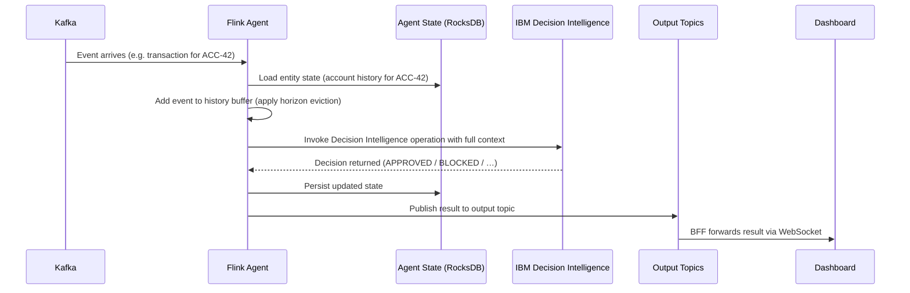

# Event Rule

> **Turn streaming event data into intelligent, real-time decisions — without touching application code.**

[](https://flink.apache.org/)
[](https://kafka.apache.org/)
[](https://www.ibm.com/products/decision-intelligence-client-managed-software)
[](https://openjdk.org/)
[](https://react.dev/)
[](https://www.apache.org/licenses/LICENSE-2.0)

---

## Table of Contents

1. [Introduction](#1-introduction)
2. [Prerequisites](#2-prerequisites)
3. [Quick Start](#3-quick-start)
4. [Architecture Overview](#4-architecture-overview)
5. [How Event Rules Work](#5-how-event-rules-work)
6. [Descriptor Wizard](#6-descriptor-wizard)
7. [Building and Testing](#7-building-and-testing)
8. [Running with Docker](#8-running-with-docker)
9. [Running Locally](#9-running-locally)
10. [Use Cases](#10-use-cases)
11. [Generating an Event Rule Application with AI](#11-generating-an-event-rule-application-with-ai)
12. [Demo Scenario Isolation](#12-demo-scenario-isolation)
13. [Project Structure](#13-project-structure)
14. [Monitoring and Troubleshooting](#14-monitoring-and-troubleshooting)
15. [Further Reading](#15-further-reading)
16. [License](#16-license)

---

## 1. Introduction

### What does this application do?

Event Rule watches streams of business events in real time — transactions, orders, logins,
account changes — and automatically makes decisions about each one.

For example: when a bank transaction arrives, the application checks it against a set of
fraud-detection rules and immediately classifies it as **APPROVED**, **REQUIRES_VERIFICATION**,
**PENDING_REVIEW**, or **BLOCKED**. It does this continuously, for every event, with low latency
(~100–150 ms end-to-end), and at scale.

### What are Agent Event Rules?

An **Agent** is a stateful processing unit that:

- **Subscribes** to one or more Kafka event streams
- **Remembers** a bounded history of events for each entity it tracks (e.g. all recent
  transactions for a given account)
- **Evaluates** each new event in full context — the new event *plus* everything the Agent
  already knows about that entity

An **Event Rule** is a business rule that decides what to do with an event. Rules are written in
plain business language using IBM Decision Designer, not code. For example:

> *"If more than 5 transactions have arrived in the last 5 minutes for this account, add 35 to
> the risk score."*

Because the Agent holds history, that rule works across events — not just for the single event
currently being processed. This is what distinguishes the Agent model from simple per-event
filtering.

### Why IBM Decision Intelligence?

[IBM Decision Intelligence](https://www.ibm.com/products/decision-intelligence-client-managed-software)
provides a visual authoring environment where business analysts write and manage rules using
decision tables and natural-language sentences — no Java or Python required.

Rules are packaged as a **Decision Service Archive** (a JAR file) and loaded directly into the
running application. When rules change, the application automatically picks up the new archive —
**no restart, no rebuild, no code deployment**.

### The core business value

| Traditional Approach                                       | Agent Event Rules                                        |
|--------------------------------------------------------------|--------------------------------------------------------------|
| Business logic baked into application code                 | Logic lives in IBM Decision Intelligence Archives        |
| Rule change = code change + build + test + redeploy (days) | Rule change = table edit + JAR export + `curl` (minutes) |
| Developers own rule changes                                 | Business analysts own rule changes                       |
| System must restart for new logic                          | Live hot-swap via Kafka broadcast state, zero downtime   |
| Single-event evaluation only                                | Full entity history available at every decision          |

---

## 2. Prerequisites

| Tool                     | Version           | Required for                                       |
|----------------------------|--------------------|-------------------------------------------------------|
| Docker & Docker Compose  | 20.10+ / V2+       | Quick Start, running the full stack                |
| Java (JDK)               | 21                 | Building/running the backend outside Docker        |
| Maven                    | 3.6+               | Building the backend                               |
| Node.js & npm            | 20.x / 10.x        | Building/running the frontend and BFF               |
| `jq`                     | any                | Sample and validation scripts                       |
| IBM Decision Designer       | running instance | Resolving IBM Decision Intelligence Maven dependencies (see [§7](#7-building-and-testing)) |

For the full list of runtime environment variables, see [`.env.example`](.env.example) and
[`DOCKER.md`](DOCKER.md).

---

## 3. Quick Start

This walks through the **Banking Fraud Agent** use case — the fastest way to see the application
work end to end.

```bash
# 1. Clone and build
git clone <repo-url>
cd event-rule
./build.sh

# 2. Start all infrastructure services
./run.sh up

# 3. Submit the banking fraud-detection job
./samples/banking-fraud-agent/scripts/deploy.sh

# 4. Open the dashboard
open http://localhost:3010
```

**Expected result:** The React dashboard opens. Click **Agent Banking** in the use-case selector.
Click any scenario button in the **Send Events** panel. A fraud-detection result appears within a
second.

> **Stop everything:** `./run.sh down`

### Services started

| Service          | URL                     | Purpose                              |
|--------------------|---------------------------|-----------------------------------------|
| Kafka            | `localhost:9092`        | Event broker                         |
| Flink JobManager | `http://localhost:8081` | Flink cluster UI + REST API          |
| BFF              | `http://localhost:8080` | Kafka-to-WebSocket bridge + REST API |
| Dashboard        | `http://localhost:3010` | React real-time event monitor        |

See [`samples/banking-fraud-agent/README.md`](samples/banking-fraud-agent/README.md) for the
fraud-detection rules, event shapes, demo scenarios, and a full end-to-end walkthrough of a
decision.

---

## 4. Architecture Overview

The system is composed of four tiers connected through Apache Kafka.

```
┌──────────────────────────────────────────────────────────────────┐
│  PRODUCER TIER                                                    │
│  React Dashboard  /  CLI (kcat)  /  External systems             │
└────────────────────────────┬─────────────────────────────────────┘
                             │  JSON events (REST → BFF → Kafka)
                             ▼
┌──────────────────────────────────────────────────────────────────┐
│  MESSAGE BROKER  —  Apache Kafka + Zookeeper                     │
│  Input:    agent-account-events, …                               │
│  Control:  <agentId>-archive-control  (optional, per agent)      │
│  Output:   agent-fraud-alerts, agent-approved-transactions, …    │
└────────────────────────────┬─────────────────────────────────────┘
                             │  KafkaSource (Flink Connector)
                             ▼
┌──────────────────────────────────────────────────────────────────┐
│  STREAM PROCESSING  —  Apache Flink 2.2.0                        │
│                                                                  │
│  AgentBasedDataStreamJob                                         │
│  ┌────────────────────────────────────────────────────────────┐  │
│  │  Per-Agent DAG Subgraph                                    │  │
│  │                                                            │  │
│  │  KafkaSources ──► union ──► keyBy(entityId)               │  │
│  │                    ▲                                       │  │
│  │  ArchiveControl ───┘  (broadcast stream)                  │  │
│  │       ▼                                                    │  │
│  │  StatefulAgentProcessor  ◄── RocksDB (keyed state)        │  │
│  │       │                                                    │  │
│  │       ├── IBM Decision Intelligence DecisionRunner (in-process)│  │
│  │       │                                                    │  │
│  │       └── Filter by eventType ──► KafkaSinks              │  │
│  └────────────────────────────────────────────────────────────┘  │
│                              │                                    │
│  (optional) Chain edge ──────┘                                    │
│  AgentChainBuilder wires Agent A output → Agent B input           │
│  in-process; no Kafka hop; Kafka source suppressed at Agent B     │
│  State: RocksDB  /  Checkpointing: EXACTLY_ONCE, 60 s            │
└────────────────────────────┬─────────────────────────────────────┘
                             │  Output Kafka topics
                             ▼
┌──────────────────────────────────────────────────────────────────┐
│  PRESENTATION TIER                                               │
│  BFF (Node.js/Express :8080)    React Dashboard (nginx :3010)    │
│  Kafka consumer → WebSocket     WebSocket client + axios REST    │
└──────────────────────────────────────────────────────────────────┘
```

### Key technical decisions

| Decision                           | Rationale                                                                                                                    |
|---------------------------------------|-----------------------------------------------------------------------------------------------------------------------------------|
| **Apache Flink**                   | Native RocksDB keyed state, exactly-once checkpointing, broadcast state API maps perfectly to zero-downtime archive reload   |
| **IBM Decision Intelligence in-process** | ~8 ms rule execution with no network hop; each archive version gets its own `URLClassLoader` for isolation              |
| **Kafka broadcast state**          | Ordered, exactly-once delivery of archive-control commands to every running subtask before the next checkpoint               |
| **JSON agent descriptor**          | New use cases require zero Java development; the full Agent DAG is built from a single JSON file                             |
| **SHA-256 integrity verification** | Archives are verified before activation; corrupted or tampered JARs are silently rejected, keeping the previous version live |

---

## 5. How Event Rules Work

The complete lifecycle of a single event, from Kafka to the dashboard:



1. **Event arrives in Kafka.** An upstream system publishes a JSON event to a Kafka topic.
2. **Flink reads and routes the event.** All events for the same entity are routed by
   `keyBy(entityId)` to the same Flink task, ensuring state is always consistent.
3. **The Agent loads entity state.** The Agent retrieves the stored profile and recent event
   history for the entity from RocksDB. State survives restarts via Flink checkpoints.
4. **The Agent updates its history.** The new event is appended to the entity's history buffer.
   The *horizon* controls how much history is kept; older events are evicted automatically.
5. **IBM Decision Intelligence is invoked.** The Agent passes the full context — the new event
   plus the entity's current profile and accumulated history — to the Decision Service.
6. **The decision is published.** The result — decision, risk score, triggered rules, alerts, and
   recommended actions — is written to a Kafka output topic.
7. **The dashboard shows the result.** The BFF forwards the result to the React dashboard in
   real time via WebSocket.

### Configuring Agents: `agents.json` and `descriptor.json`

Every use case is defined by two JSON files — no application code required:

- **`agents.json`** — the execution contract: which entity the Agent tracks, which Kafka topics
  it subscribes to, how much history it keeps, which Decision Intelligence operation it invokes,
  and where it publishes results.
- **`descriptor.json`** — the presentation contract: which of those topics the dashboard displays
  and how they are labeled.

**[`docs/AGENT_PATTERN_DESIGN.md`](docs/AGENT_PATTERN_DESIGN.md) is the authoritative reference**
for both file formats, the generic rule-execution context, state management, and the Flink DAG
architecture.

For agent chaining, multi-input agents, parallel processing, and other patterns beyond a single
agent processing a single event type, see
**[`docs/ADVANCED_PATTERNS.md`](docs/ADVANCED_PATTERNS.md)**.

---

## 6. Descriptor Wizard

The **Descriptor Wizard** is a multi-step form built into the dashboard that lets you create or
edit an agent descriptor entirely from the UI — no manual JSON editing required.

Open it from the use-case selector by clicking **New Agent Descriptor** (or **✎ Edit** on an
existing card).

### Steps

| Step | Name               | What you configure                                                                        |
|------|--------------------|-------------------------------------------------------------------------------------------|
| 1    | Job & Identity     | Agent ID, display name, entity type, entity key extractor, parallelism, agent chaining    |
| 2    | Subscriptions      | Kafka input topics, event types, operations, event-history horizon                        |
| 3    | Ruleset            | Decision archive source, archive-control topic, operation field mappings                  |
| 4    | Outputs            | Output event types and Kafka topics                                                       |
| 5    | State & Review     | State TTL, backend, entity changelog topic, full JSON preview                             |
| 6    | Publish & Deploy   | Upload JAR, save descriptor, start/stop Flink job                                         |

### Step 3 — Ruleset: two ways to provide a decision archive

The Ruleset step supports two paths for supplying the Decision Intelligence archive.
Both paths set the same `ruleset.path` field in `agents.json`; all downstream
processing (Step 6 upload, Flink job, hot-swap) is identical regardless of how the
archive was obtained.

```
Ruleset Step
     │
     ┌─────────────────────┬──────────────────────────┐
     ▼                     ▼
Upload Decision Archive   Fetch from DI Runtime
     │                          │
     │                   Select runtime instance
     │                          │
     │                   Browse deployed decisions
     │                          │
     │                   Select Decision ID
     │                          │
     │                   ⬇ Fetch Archive
     │                   (saved to samples/<agentId>/)
     │                          │
     └──────────┬───────────────┘
                ▼
     Existing Ruleset Processing
     (validateStep, buildDescriptor, StepPublish)
```

#### Option A — Upload a local archive

Click **↑ Upload Decision Archive**, choose a `.jar` file from your local filesystem.
The file is staged in the browser and uploaded to `samples/<agentId>/` on the BFF server
at Step 6.

#### Option B — Fetch from a DI Runtime

Click **⬇ Fetch from DI Runtime** to browse decisions deployed on a configured IBM
Automation Decision Services instance:

1. **Select runtime** — choose from the list of configured DI runtimes.
2. **Browse decisions** — the wizard loads the list of deployed decisions from the runtime.
3. **Select a decision** — pick by Decision ID (name and status are shown for context).
4. **Fetch archive** — the BFF downloads the archive directly from the runtime and saves
   it to `samples/<agentId>/<decisionId>.jar`. The path is set automatically.

> **No local file is required.** The archive is downloaded server-side by the BFF, so the
> browser never handles the binary payload.

### Configuring DI runtimes

DI runtimes are declared in the `DI_RUNTIMES` environment variable (read by the BFF at
startup). Each entry is a JSON object:

```json
[
  {
    "id":       "ads-dev",
    "name":     "DI Development",
    "url":      "http://ads-dev:9060",
    "username": "admin",
    "password": "secret"
  }
]
```

| Field      | Required | Description                                              |
|------------|----------|----------------------------------------------------------|
| `id`       | ✓        | Unique identifier used in BFF API routes                 |
| `name`     | ✓        | Display name shown in the wizard                         |
| `url`      | ✓        | Base URL of the DI runtime (no trailing slash)          |
| `username` |          | HTTP Basic auth username (omit if no auth)               |
| `password` |          | HTTP Basic auth password                                 |

Credentials are consumed server-side only and are **never sent to the browser**.

See [`.env.example`](.env.example) for the full configuration block and
[`event-rule-frontend/bff/README.md`](event-rule-frontend/bff/README.md) for the BFF API reference.

### BFF API endpoints added

| Method | Path                                                            | Description                                       |
|--------|-----------------------------------------------------------------|---------------------------------------------------|
| `GET`  | `/api/ads-runtimes`                                             | List configured DI runtimes (no credentials)     |
| `GET`  | `/api/ads-runtimes/:id/decisions`                               | List decisions deployed on a runtime              |
| `POST` | `/api/ads-runtimes/:id/decisions/:decisionId/archive?agentId=` | Download and save an archive from a runtime       |

---

## 7. Building and Testing

### Build

```bash
# Build everything (backend JAR + frontend static assets)
./build.sh

# Backend only
cd event-rule-backend && mvn package -DskipTests

# Frontend only
cd event-rule-frontend && npm install && npm run build
```

The build produces:
- `event-rule-backend/target/event-rule-backend-1.0-SNAPSHOT.jar` — fat JAR with all dependencies
- `event-rule-frontend/build/` — static React app served by nginx

### Run tests

```bash
# All backend tests
cd event-rule-backend && mvn test

# Specific test class
mvn test -Dtest=StatefulAgentProcessorTest

# Frontend tests
cd event-rule-frontend && npm test
```

**Backend test classes:**

| Class                          | What it tests                                                                                                          |
|--------------------------------|------------------------------------------------------------------------------------------------------------------------|
| `AgentBasedDataStreamJobTest`  | DAG construction, descriptor loading, entity ID extraction, `__eventType` override, per-agent `chainingEnabled` flag, `CHAINING_ENABLED` env var parsing and kill-switch semantics |
| `AgentChainBuilderTest`        | Chain detection, self-loop guard, null-stream safety                                                                   |
| `StatefulAgentProcessorTest`   | State management, horizon eviction, context formatting, error handling, per-entity and global reset                    |
| `AgentDescriptorTest`          | Descriptor JSON parsing and validation                                                                                 |
| `DeploymentApiServerTest`      | HTTP routing, request validation, error responses                                                                      |
| `ArchiveDownloaderTest`        | Download, SHA-256 verification, cache behaviour                                                                        |
| `DeploymentAuditLogTest`       | Audit log entry recording                                                                                              |

**Frontend test files:**

| File                            | What it tests                                                                                                                         |
|---------------------------------|---------------------------------------------------------------------------------------------------------------------------------------|
| `AgentWizard.test.js`           | `descriptorToForm`, `buildDescriptor`, round-trips, step validation, edit-agent URL, `jarState` derivation, `chainingEnabled` mapping |
| `DIRuntimeFetch.test.js`        | BFF DI routes (runtime list, decision list, archive download), error paths, agentId validation, pipeline integration                  |
| `AgentManagementPanel.test.js`  | Stop/delete fetch URL, `useCaseId` vs `agentId` prop separation                                                                       |
| `KafkaNotifications.test.js`    | WebSocket notification hook                                                                                                           |

### IBM Decision Intelligence Maven dependencies

IBM Decision Intelligence Maven dependencies (`execution-api`, `engine-de-api`, `foundation`)
are resolved from a locally installed IBM Decision Designer instance via the `maven-designer`
Maven profile. Run the resolver script once before the first build:

```bash
export DI_ZEN_HOSTNAME="cpd-cp4a.mycompany.com"
export DI_ZEN_USERNAME="admin"
export DI_ZEN_API_KEY="<api-key-from-cp4ba-ui>"
./scripts/resolve-di-dependencies.sh
```

Then build with:

```bash
mvn clean package -s settings.xml -P maven-designer -pl event-rule-backend
```

See [Building against a local Decision Designer installation](#building-against-a-local-decision-designer-installation)
for the full walkthrough and TLS options.

### Building a Decision Service archive

Use [`scripts/build-decision-service.sh`](scripts/build-decision-service.sh) to build an IBM
Decision Intelligence Decision Project directory or `.zip` file against a Decision Designer
instance. Example:

```bash
export DI_USERNAME="<cp4ba-username>"
export DI_API_KEY="<zen-api-key>"

./scripts/build-decision-service.sh \
  --project "samples/banking-fraud-agent/di-project/Fraud Detection Service.zip" \
  --output ./dist \
  --di-url "https://cpd-cp4a.mycompany.com/ads"
```

On success the output JAR is placed in `./dist/` with its SHA-256 printed to stdout.
See [`scripts/README.md`](scripts/README.md) for all options, prerequisites, and
troubleshooting.

### Building against a local Decision Designer installation

Resolve `execution-api.jar`, `engine-de-api.jar`, and the required Jackson JARs from a
locally installed IBM Decision Designer using the `maven-designer` Maven profile:

```bash
export DI_ZEN_HOSTNAME="cpd-cp4a.mycompany.com"
export DI_ZEN_USERNAME="admin"
export DI_ZEN_API_KEY="<api-key-from-cp4ba-ui>"

./scripts/resolve-di-dependencies.sh

mvn clean package -s settings.xml -P maven-designer -pl event-rule-backend
```

Set `DI_SKIP_TLS_VERIFY=true` for self-signed certificates (development only).
See [`scripts/README.md`](scripts/README.md#resolve-di-dependenciessh--resolve-ibm-ads-jars-from-a-local-decision-designer)
for the full walkthrough, version cross-check details, and TLS options.

---

## 8. Running with Docker

The full stack — Kafka, Flink, the BFF, and the dashboard — runs via Docker Compose:

```bash
./run.sh up      # start all services
./run.sh logs    # follow logs
./run.sh down    # stop all services
```

For image configuration, resource limits, rebuilding after code changes, and troubleshooting
Docker-specific issues, see **[`DOCKER.md`](DOCKER.md)**.

---

## 9. Running Locally

Each component can also run outside Docker for local development:

- **Backend (Flink job):** see
  [`docs/RUN_DATASTREAM.md`](docs/RUN_DATASTREAM.md) for running
  `AgentBasedDataStreamJob` directly against a local or remote Kafka broker.
- **Frontend (dashboard):** see [`event-rule-frontend/README.md`](event-rule-frontend/README.md) for `npm start` and
  environment variable configuration.
- **BFF:** see [`event-rule-frontend/bff/README.md`](event-rule-frontend/bff/README.md) for `npm start` / `npm run dev`
  and the full REST API reference.

---

## 10. Use Cases

Event Rule ships with sample use cases under [`samples/`](samples/), each a self-contained
Agent descriptor, Decision Intelligence archive, and set of demo scenarios.

**See [`samples/README.md`](samples/README.md)** for the full list of available use cases and
how to run them.

| Use case                                                              | Description                                                                     |
|--------------------------------------------------------------------------|--------------------------------------------------------------------------------------|
| [Banking Fraud Agent](samples/banking-fraud-agent/README.md)         | Evaluates transactions against an account's full history; flags fraud in real time |
| [Air Traffic Control](samples/airtraffic-agent/README.md)            | Cross-domain agent chaining: Aircraft Agent feeds Airport Agent directly in-process |

Want to build your own use case? Follow **[`TUTORIAL.md`](TUTORIAL.md)** for a complete
step-by-step guide, from creating the use-case directory through running and validating it.

---

## 11. Generating an Event Rule Application with AI

You don't need to create every file of an Event Rule application by hand. Instead, you can
describe the application you want in a **Markdown specification** and ask a capable coding AI
assistant — such as [Claude](https://claude.ai) or [IBM Bob](https://ibm.com) — to generate
the complete application configuration from that description.

The AI reads your specification, studies the existing sample applications as worked examples,
and produces the two configuration files that every Event Rule application requires:
`descriptor.json` and `agents.json`.

---

### 11.1 Prepare the specification

Copy the template and fill it in:

```
samples/Event Rule Application Template.md
```

The template is divided into three main sections:

| Section | What to fill in |
|---------|----------------|
| **Introduction** | A short description of what the application does |
| **Application** | Application name, inbound Kafka topics (with event types), outbound Kafka topics, and an optional `consumerGroupId` |
| **Agents** | One sub-section per Agent describing: entity type, subscribed events with their horizon (time window or count), the ruleset JAR file, the operations it exposes with their input/output fields, state TTL, and control/changelog/error topics |

The specification does not need to match the template character for character. The AI can
interpret a document that follows the same general structure and contains all the required
information. The two completed sample specifications below show how the template maps to a
real application.

**Skeleton** (minimum viable structure):

```markdown
# My Application

## Introduction
Brief description of what this application does.

## Application

Application Name: My App Name

List of inbound topics:
* `my-inbound-topic`, receiving events of type `MyEvent`

List of outbound topics:
* `my-outbound-topic`, sending events of type `MyOutputEvent`

## Agents

### My Agent

#### Specification

`My Agent` is an agent related to a `MyEntity` subscribing to:
   * `MyEvent` from `my-inbound-topic`, keeping them for 1 hour and processed by `ProcessMyEvent` operation

#### Ruleset

The processing ruleset is `MyService_1.0.0.jar`, defining the following operations:

* `ProcessMyEvent` taking as input:
   * `myEntity` as the entity,
   * `myEvent` as the event,
   * history of `MyEvent` as `pastEvents`

  generating:
   * a collection of `MyOutputEvent` as `outputEvents`

The ruleset control topic is `my-archive-control`.

Entity changes are published to `my-entity-changelog`.

Agent Errors are published to `my-errors`.

#### Output

* `MyOutputEvent` events are sent to `my-outbound-topic`

#### Configuration

The state is stored on `rocksdb` with a time-to-live of 24 hours.
```

---

### 11.2 Give the specification and prompt to the AI

Open the project in your AI coding assistant (Claude, Bob, or equivalent) and provide **both**:

1. **Your specification** — the `.md` file you just created.
2. **The generation prompt** — adapted from [`samples/PROMPT.md`](samples/PROMPT.md).

The prompt instructs the AI to:

- Read your Event Rule Application specification.
- Read the existing sample applications as worked examples.
- Understand what files need to be generated and how they should be structured.
- Generate `descriptor.json` and `agents.json` for your application under a new directory inside `samples/`.
- Follow all naming conventions and structural patterns already used by the project.

**Ready-to-copy prompt:**

````
From samples/<YOUR-DIRECTORY>/<Your Application>.md, generate an Event Rule descriptor JSON
file and an agents JSON file in samples/<YOUR-DIRECTORY>/.

Use the following existing samples as worked examples showing exactly how a Markdown
specification maps to the generated JSON files:
  - samples/airtraffic-agent/Air Traffic Control Application.md
    → samples/airtraffic-agent/descriptor.json
    → samples/airtraffic-agent/agents.json
  - samples/banking-fraud-agent/descriptor.json  (reference for field structure and conventions)

Follow the same structure, field names, naming conventions, and patterns used in those
examples. Do not invent fields or configuration that is not described in the specification
or demonstrated by the existing samples.
````

Replace `<YOUR-DIRECTORY>` with the folder name you chose (e.g. `my-app-agent`) and
`<Your Application>` with the name of your `.md` file.

---

### 11.3 Reference examples

Two completed specifications are included in the repository. The Air Traffic Control example
is paired with its fully generated output files:

| Specification | Generated files |
|---------------|----------------|
| [`samples/airtraffic-agent/Air Traffic Control Application.md`](samples/airtraffic-agent/Air%20Traffic%20Control%20Application.md) | [`descriptor.json`](samples/airtraffic-agent/descriptor.json), [`agents.json`](samples/airtraffic-agent/agents.json) |
| [`samples/retail-agent/Retail Event Rule Application.md`](samples/retail-agent/Retail%20Event%20Rule%20Application.md) | *(specification only — useful as a second domain example)* |

The **Air Traffic Control** example is the most complete reference: it contains two agents
(`Aircraft Agent` and `Airport Agent`) that chain their output, uses multiple event horizons,
and demonstrates every field that can appear in `agents.json` and `descriptor.json`. Comparing
the `.md` specification with the two generated JSON files side by side is the fastest way to
understand exactly how each section of the specification maps to the generated configuration.

The **Retail Event Rule Application** specification illustrates a simpler single-agent application
(a `Customer Agent` that tracks orders and generates promotions). Use it as an additional input
example to confirm the AI generalises correctly to a different domain.

---

### 11.4 Step-by-step workflow

```
1. Copy the template:
     samples/Event Rule Application Template.md
     → samples/<your-app-agent>/<Your Application>.md

2. Fill in the template: application name, topics, agents,
   rulesets, operations, horizons, state TTL, and control topics.

3. Open the project with your AI assistant (Claude / Bob).

4. Paste the generation prompt from §11.2, replacing
   <YOUR-DIRECTORY> and <Your Application> with your values.

5. Point the AI to your specification and to the existing
   sample applications (airtraffic-agent, banking-fraud-agent).

6. The AI generates:
     samples/<your-app-agent>/descriptor.json
     samples/<your-app-agent>/agents.json

7. Review the generated files against your specification:
     - Every inbound topic  → entry in descriptor.json "topics"
     - Every outbound topic → entry in "outboundTopics"
     - Every agent          → entry in agents.json "agents"
     - Every subscription horizon → correct "horizon" block
     - Every operation input/output → "history" / "outbounds" arrays

8. Load the application through the Descriptor Wizard (§6),
   or place the files in your sample directory and restart
   the BFF to pick them up automatically.
```

---

## 12. Demo Scenario Isolation

When the **Send Events** panel is used to run demo scenarios, each "Run Scenario" click
automatically resets the Flink state left by the **previous** scenario before publishing the
new one.  This guarantees each scenario starts from a clean slate — no bleed-through from
prior runs.

### How it works

Each scenario's events carry an entity key (e.g. `accountNumber`).  Before the new scenario's
events are published, the frontend calls:

```
POST /api/use-cases/:useCase/reset-entities
{ "scenarioId": "<id-of-the-previous-scenario>" }
```

The BFF reads the scenario's event payloads, extracts the distinct entity key values, and
publishes one **reset sentinel** per entity to the first subscribed event topic:

```json
{ "__eventType": "__ENTITY_RESET__", "accountNumber": "111" }
```

Apache Flink routes the sentinel via `keyBy(entityId)` to the exact keyed partition for that
entity.  The [`StatefulAgentProcessor`](event-rule-backend/src/main/java/com/ibm/di/event/agent/StatefulAgentProcessor.java)
detects `__ENTITY_RESET__` and clears the `AgentState` for that entity — both the entity profile
(`entityData`) and the complete event history (`eventHistories`).  No other entity is affected.
No output event is emitted.  The rule engine is not invoked.

Reset sentinels are filtered from the dashboard's event list — they are logged server-side for
audit purposes only.

### Global reset (broadcast)

A separate **`RESET_STATE`** command exists on the archive-control broadcast channel and wipes
**all** entity state simultaneously.  This is intended for staging environments or emergency
purges, not for regular scenario switching.  See
[`docs/AGENT_PATTERN_DESIGN.md`](docs/AGENT_PATTERN_DESIGN.md) for details.

### CLI usage

The [`launch-demo-scenario.sh`](scripts/launch-demo-scenario.sh) script performs the same
per-entity reset automatically after each scenario.  Pass `--no-reset` to skip it:

```bash
# Run a scenario with automatic entity reset (default)
./scripts/launch-demo-scenario.sh banking-fraud-agent transaction-on-suspended-account

# Skip the reset step
./scripts/launch-demo-scenario.sh banking-fraud-agent transaction-on-suspended-account --no-reset
```

---

## 13. Project Structure

```
event-rule/
├── event-rule-backend/                   # Apache Flink Java application
│   ├── src/main/java/com/ibm/di/event/
│   │   ├── agent/                        # Agent pattern (primary implementation)
│   │   │   ├── AgentBasedDataStreamJob.java   # Flink entry point; builds DAG from agents.json
│   │   │   ├── AgentChainBuilder.java         # Resolves inter-agent stream wiring; honours per-agent chainingEnabled + CHAINING_ENABLED global override
│   │   │   ├── StatefulAgentProcessor.java    # Core KeyedBroadcastProcessFunction
│   │   │   ├── AgentDescriptor.java           # Agent descriptor model (incl. chainingEnabled field)
│   │   │   ├── AgentState.java                # RocksDB-persisted per-entity state
│   │   │   ├── EventEnvelope.java             # Flink-safe event carrier
│   │   │   ├── EventSubscription.java
│   │   │   ├── HorizonConfig.java
│   │   │   ├── OutputConfig.java
│   │   │   ├── RulesetConfig.java
│   │   │   └── StateConfig.java
│   │   ├── rule/                         # IBM Decision Intelligence integration layer
│   │   │   ├── RuleEngineRunner.java          # IBM DecisionRunner adapter (URLClassLoader)
│   │   │   ├── SampleInputGenerator.java      # CLI tool; BFF spawns as child process
│   │   │   └── broadcast/                     # Broadcast-state archive reload
│   │   │       ├── ArchiveControlCmd.java     # Control message model (LOAD/ROLLBACK/PREFETCH)
│   │   │       ├── ArchiveDownloader.java     # Download + SHA-256 verify + JVM cache
│   │   │       ├── ArchiveEntry.java
│   │   │       ├── ArchiveVerificationException.java
│   │   │       └── DeploymentAuditLog.java
│   │   ├── api/                          # Embedded REST API (Deployment Control)
│   │   │   ├── DeploymentApiServer.java       # JDK HttpServer, zero extra deps
│   │   │   ├── KafkaCommandPublisher.java
│   │   │   ├── DeployArchiveRequest.java
│   │   │   └── ApiErrorResponse.java
│   └── src/test/                         # Unit tests (all agent-related)
│
├── event-rule-frontend/
│   ├── bff/                              # Backend-for-Frontend (Node.js/Express)
│   │   └── server.js                    # Kafka consumer + WebSocket bridge + REST API
│   │                                    #   includes /api/ads-runtimes/* routes
│   └── src/                             # React 18 dashboard (Vite)
│       ├── AgentWizard.js               # Descriptor Wizard (all steps incl. Ruleset DI fetch, chainingEnabled)
│       ├── AgentWizard.css              # Wizard styles (incl. source-selector, DI panel)
│       ├── AgentWizard.test.js          # Wizard unit tests
│       └── DIRuntimeFetch.test.js       # DI runtime fetch unit tests
│
├── samples/
│   ├── banking-fraud-agent/             # Banking fraud detection — chainingEnabled: false
│   │   ├── README.md                    # Use-case documentation
│   │   ├── agents.json                  # Agent descriptor
│   │   ├── descriptor.json              # BFF use-case descriptor
│   │   ├── demo-scenarios.json          # Pre-built demo scenarios
│   │   ├── FraudDetectionService_1.5.2.jar  # Pre-built Decision Intelligence archive
│   │   ├── di-project/                  # IBM Decision Intelligence project source
│   │   └── scripts/
│   │       └── deploy.sh               # Submit the Flink job for this use case
│   └── airtraffic-agent/               # Air Traffic Control — cross-domain agent chaining (chainingEnabled: true)
│       ├── README.md                    # Use-case documentation
│       ├── agents.json                  # Agent descriptor (Aircraft + Airport agents)
│       └── descriptor.json             # BFF use-case descriptor
│
├── docs/
│   ├── AGENT_PATTERN_DESIGN.md          # Authoritative reference: descriptor schemas, DAG architecture
│   ├── ADVANCED_PATTERNS.md             # Chaining, multi-input, parallel processing, worked examples
│   ├── RULE_ENGINE.md                   # IBM Decision Intelligence class hierarchy, RuleEngineRunner internals
│   └── RUN_DATASTREAM.md               # Running the Flink job locally without Docker
│
├── docker-compose.yml                   # All services (Kafka, Flink, BFF, Frontend)
├── build.sh                             # Build all components
├── run.sh                               # Start/stop infrastructure
├── pom.xml                              # Maven parent POM
│
├── README.md                            # This file
├── TUTORIAL.md                          # Step-by-step guide to building a new use case
└── DOCKER.md                            # Docker Compose reference
```

---

## 14. Monitoring and Troubleshooting

**Watch the TaskManager logs to see every decision:**

```bash
./run.sh log
```

Each event produces structured log lines; output events and archive reloads are logged at `INFO`
level. **Flink Web UI:** `http://localhost:8081` — job DAG, checkpoint history, operator
throughput, backpressure indicators.

| Problem                                     | What to check                                                                                                                 |
|---------------------------------------------|-------------------------------------------------------------------------------------------------------------------------------|
| Dashboard shows "Connecting…"               | BFF is not running — `docker ps \| grep bff` and `./run.sh logs bff`                                                          |
| No events appearing                         | Check Kafka: `docker exec kafka kafka-console-consumer --topic <topic> --from-beginning --bootstrap-server localhost:9092`    |
| Rules not firing                            | Check for smoke-test warnings in TaskManager logs; verify `ruleset.path` points to an existing JAR                            |
| `Could not find decision runner` error      | The `operation` in each subscription must match the operation name exported by IBM Decision Designer exactly (case-sensitive). Verify the operation's decision flow is registered in the JAR's `META-INF/services/com.ibm.decision.run.DecisionServiceProvider` — a missing service entry is the most common cause. |
| State lost after restart                    | Flink restores from the last checkpoint; allow at least one checkpoint interval (60 s) before restarting                      |
| DI wizard shows "No DI runtimes configured" | Set `DI_RUNTIMES` in `.env` (see [§6](#6-descriptor-wizard)) and restart the BFF                                             |
| DI wizard shows "Could not load runtimes"   | BFF cannot reach `GET /api/ads-runtimes` — check BFF logs; if running locally, ensure BFF is started                          |
| DI fetch returns "authentication failed"    | `username`/`password` in `DI_RUNTIMES` do not match the DI runtime — check credentials in `.env`                            |
| DI fetch returns "Failed to connect"        | DI runtime is unreachable from the BFF — check `url` in `DI_RUNTIMES` and network/firewall rules                             |

For use-case-specific troubleshooting (e.g. banking fraud scenarios), see
[`samples/banking-fraud-agent/README.md`](samples/banking-fraud-agent/README.md#9-troubleshooting).
For Docker-specific issues, see [`DOCKER.md`](DOCKER.md#troubleshooting). For BFF API and
archive hot-swap internals, see [`event-rule-frontend/bff/README.md`](event-rule-frontend/bff/README.md) and
[`docs/RULE_ENGINE.md`](docs/RULE_ENGINE.md).

---

## 15. Further Reading

| Document                                                                                      | Contents                                                                                            |
|--------------------------------------------------------------------------------------------------|----------------------------------------------------------------------------------------------------------|
| [`docs/AGENT_PATTERN_DESIGN.md`](docs/AGENT_PATTERN_DESIGN.md)                                | Authoritative reference: `agents.json`, `descriptor.json`, state management, Flink DAG architecture |
| [`docs/ADVANCED_PATTERNS.md`](docs/ADVANCED_PATTERNS.md)                                      | Agent chaining, multi-input agents, parallel processing, worked examples                            |
| [`TUTORIAL.md`](TUTORIAL.md)                                                                   | Step-by-step guide to building a new use case                                                       |
| [`samples/README.md`](samples/README.md)                                                       | Overview of all available use cases                                                                 |
| [`DOCKER.md`](DOCKER.md)                                                                       | Docker Compose reference, image configuration, troubleshooting                                      |
| [`docs/RULE_ENGINE.md`](docs/RULE_ENGINE.md)                                                  | IBM Decision Intelligence `RuleEngineRunner` internals, archive hot-swap, reload mechanics          |
| [`docs/RUN_DATASTREAM.md`](docs/RUN_DATASTREAM.md)                                           | Running the Flink job locally without Docker                                                        |
| [`event-rule-frontend/bff/README.md`](event-rule-frontend/bff/README.md)                      | BFF architecture, full REST API reference                                                           |
| [`scripts/README.md`](scripts/README.md)                                                       | Operational scripts: topic creation, event submission, deployment validation, monitoring            |
| [Apache Flink Documentation](https://nightlies.apache.org/flink/flink-docs-release-2.2/)      | Flink 2.2.0 reference                                                                                |
| [IBM Decision Intelligence](https://www.ibm.com/products/decision-intelligence-client-managed-software) | IBM Decision Intelligence product page                                                              |

---

## 16. License

Licensed under the [Apache License, Version 2.0](https://www.apache.org/licenses/LICENSE-2.0).

