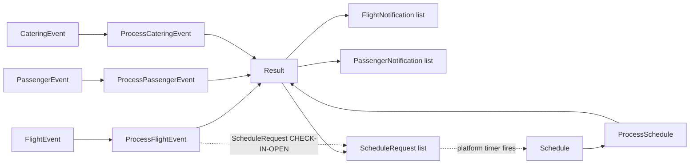
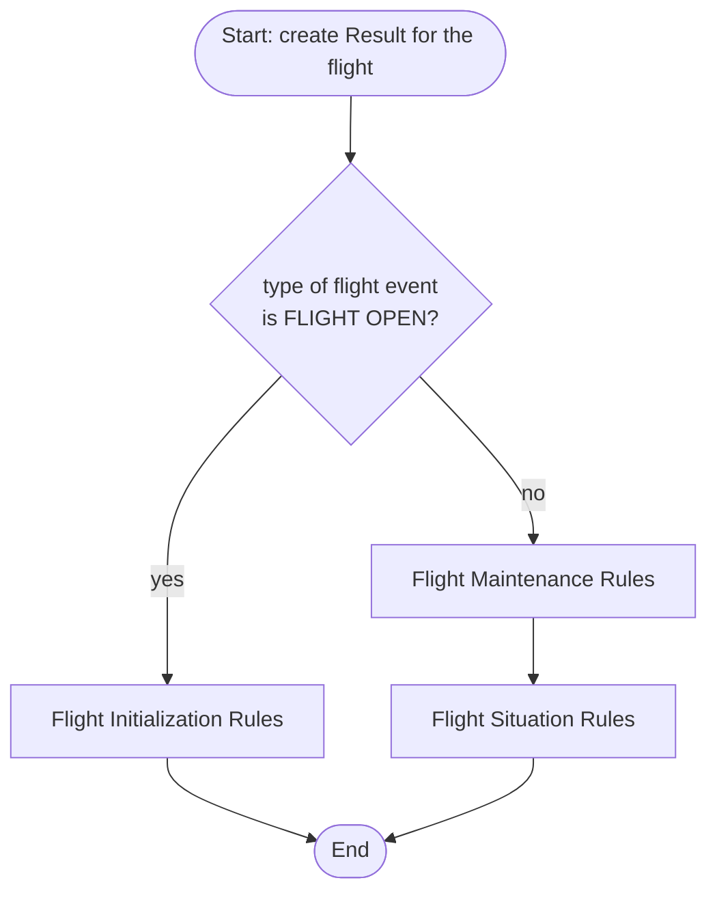
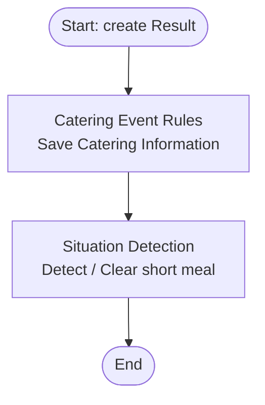
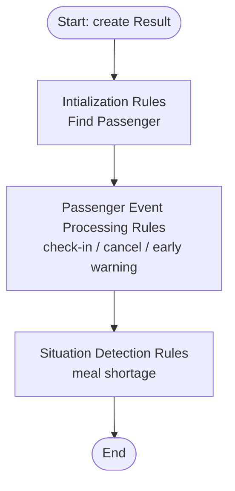
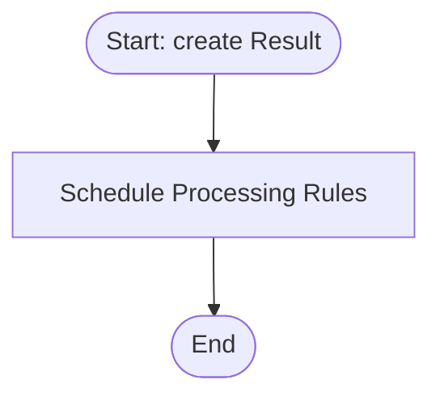
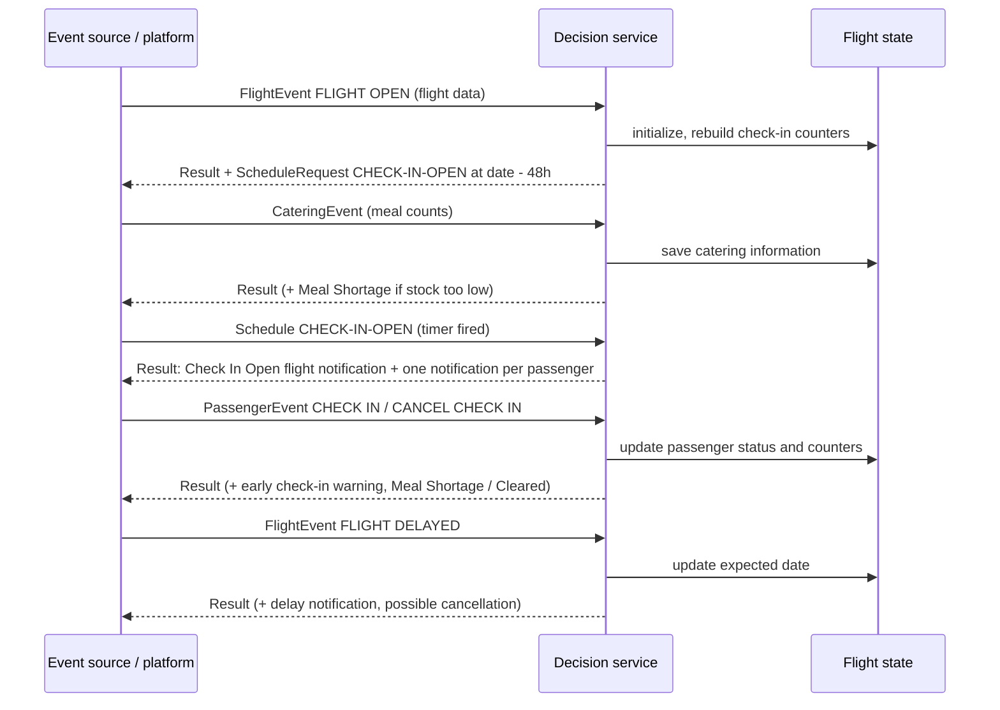

# Airline Decision Service – Event Processing

This document explains how the rules of the `AirlineDecisionService` project process incoming events.

Related documents:
- [Ontology](ontology.md) – the concepts, properties and functions used below
- [Situations](situations.md) – the situations detected by the rules

---

## 1. Overview

The decision service exposes **four operations**. Each one receives one kind of event, the current [Flight](ontology.md#flight) and a few context values. It runs a **ruleflow** (an ordered pipeline of rule packages), updates the flight in place and returns a [Result](ontology.md#result).

| Operation (runtime name) | Rule project | Ruleflow | Triggering event |
|---|---|---|---|
| `ProcessFlightEvent` | Process Flight Event | Process Flight Event Flow | [FlightEvent](ontology.md#flightevent) |
| `ProcessPassengerEvent` | Process Passenger Event | Passenger Event Processing Flow | [PassengerEvent](ontology.md#passengerevent) |
| `ProcessCateringEvent` | Process Catering Event | Catering Event Processing Flow | [CateringEvent](ontology.md#cateringevent) |
| `ProcessSchedule` | Process Schedule Event | Schedule Event Processing Flow | [Schedule](ontology.md#schedule) |

All operations share the same `AirlineDataModel` project (see [ontology](ontology.md)).

### 1.1 Common inputs and outputs

Every operation is stateless: the caller supplies the state and receives the changes.

| Variable | Verbalization | Type | Direction | Notes |
|---|---|---|---|---|
| `now` | now | ZonedDateTime | in | Current time, used for timestamps and time windows. |
| `flight` | the flight | [Flight](ontology.md#flight) | in | Modified in place by the rules and returned in `result.flight`. For a `FLIGHT OPEN` event it is empty and gets initialized from the event. |
| `result` | the result | [Result](ontology.md#result) | **out** | Created by the ruleflow start action. |

Each operation adds its own event input and history, listed in its section.

### 1.2 Common ruleflow start action

All four ruleflows start with the same step:

> Create a new [Result](ontology.md#result) whose `flight` is *the flight*.

Rules then append notifications and schedule requests to this Result.

---

## 2. Rule execution modes

| Mode | Used by | Meaning (plain English) |
|---|---|---|
| Fastpath | most packages | Rules are evaluated in a sequential, compiled fashion. Efficient when rules do not need to re-trigger each other. |
| RetePlus | *Flight State Maintenance Rules* | Rete-based inference engine: rules re-evaluate when data they depend on changes. |

---

## 3. Operations

### 3.1 Process Flight Event (`ProcessFlightEvent`)

**Extra inputs:** `flightEvent` ([FlightEvent](ontology.md#flightevent)), `pastFlightEvents` (list of earlier [FlightEvent](ontology.md#flightevent)).

**Routing:** a `FLIGHT OPEN` event goes to initialization only. Every other event goes through maintenance, then situation rules.

| Package | Rule | When it fires | What it does |
|---|---|---|---|
| Flight Initialization Rules | **Flight Initialization Rule** | event type is `FLIGHT OPEN` | Takes the flight carried by the event, runs [ValidateFlight](ontology.md#validateflight) on it, makes it *the flight* and the `flight` of the Result. Adds a [ScheduleRequest](ontology.md#schedulerequest) (`id` = `CHECK-IN-OPEN`, `status` = `START`) due **48 hours before the flight date**. |
| Flight Initialization Rules | **Initialize Checkin Status** | for each passenger of the event's flight whose status is *Checked In* | Calls [CheckPassengerIn](ontology.md#checkpassengerin) so the [CheckinCounter](ontology.md#checkincounter) reflects passengers already checked in when the flight is opened. |
| Flight State Maintenance Rules | **Flight Delayed Rule** | event type is `FLIGHT DELAYED` | Copies `expectedDate` from the event's flight to *the flight*. |
| Flight Event Processing Rules (situation rules) | **Flight Delayed Notification Rule** | event is `FLIGHT DELAYED` **and** no `FLIGHT DELAYED` event in the past flight events within the last 30 minutes | Adds a [FlightNotification](ontology.md#flightnotification) “Flight as being delayed. new expected time: …”. See [Delay notification](situations.md#21-flight-delay-first-notification). |
| Flight Event Processing Rules (situation rules) | **Detect Flight Possible Cancellation** | event is `FLIGHT DELAYED` **and** at least 2 `FLIGHT DELAYED` events in the past flight events during the last 30 minutes | Adds an `Information` [FlightNotification](ontology.md#flightnotification) warning of a possible cancellation. See [Possible cancellation](situations.md#22-possible-flight-cancellation-burst-of-delays). |

Notes:
- The delay rules look only at `pastFlightEvents` supplied by the caller. Whether that list already contains the current event depends on the caller.
- Event types other than `FLIGHT OPEN` and `FLIGHT DELAYED` (`FLIGHT CANCELLED`, `FLIGHT CLOSE`, `FLIGHT INFO`, `PASSENGER ADDED/MODIFIED/REMOVED`) pass through the ruleflow without any rule firing.

---

### 3.2 Process Catering Event (`ProcessCateringEvent`)

**Extra inputs:** `cateringEvent` ([CateringEvent](ontology.md#cateringevent)), `pastCateringEvents`, `pastFlightEvent` (both lists are declared but not used by any rule).

| Package | Rule | When it fires | What it does |
|---|---|---|---|
| Catering Event Rules | **Save Catering Information** | always | Stores the event's [CateringInformation](ontology.md#cateringinformation) on *the flight*. |
| Situation Detection | **Detect Short Meal Situation** | flight is not in short meal situation **and** [CateringIsGood](ontology.md#cateringisgood) is false | Opens a [meal shortage](situations.md#3-meal-shortage). |
| Situation Detection | **Short Meal Situation Cleared** | flight is in short meal situation **and** catering is good | Closes the [meal shortage](situations.md#3-meal-shortage). |

The catering data is saved first so the situation check uses the new meal counts.

---

### 3.3 Process Passenger Event (`ProcessPassengerEvent`)

**Extra inputs:** `passengerEvent` ([PassengerEvent](ontology.md#passengerevent)), `pastPassengerEvents` (declared, unused by rules). Internal variable: `passenger` ([Passenger](ontology.md#passenger)).

| Package | Rule | When it fires | What it does |
|---|---|---|---|
| Intialization Rules | **Find Passenger** | always | Looks in the flight's passengers for the first one whose `passengerId` equals the event's `passengerId` and sets it as *the passenger*. |
| Passenger Event Processing Rules | **Passenger Check-In** | `CHECK IN` event that occurs **inside** the check-in window (less than 48 h before the flight) | Runs [CheckPassengerIn](ontology.md#checkpassengerin): status *Checked In*, counter +1. |
| Passenger Event Processing Rules | **Early Passenger Check-In** | `CHECK IN` event that occurs **before** the check-in window opens (more than 48 h before the flight) | Does not check in. Adds an `Information` [FlightNotification](ontology.md#flightnotification) “Warning: Passenger … checked-in at …, before check-in is open”. See [Early check-in](situations.md#4-early-check-in-attempt). |
| Passenger Event Processing Rules | **Passenger Cancel Check-In** | `CANCEL CHECK IN` event | Runs [CancelPassengerCheckIn](ontology.md#cancelpassengercheckin): status *Cancelled*, counter −1. |
| Situation Detection Rules | **Detect Meal Shortage Situation** | `CHECK IN` or `CANCEL CHECK IN` **and** flight not in short meal situation **and** catering not good | Opens a [meal shortage](situations.md#3-meal-shortage). |
| Situation Detection Rules | **Meal Shortage Situation Cleared** | `CHECK IN` or `CANCEL CHECK IN` **and** flight in short meal situation **and** catering good | Closes the [meal shortage](situations.md#3-meal-shortage). |

Notes:
- The check-in counters are updated before situation detection runs, so the shortage test sees the effect of the current event.
- `NO SHOW` events are not handled by any rule.
- The rules do not handle the case where no passenger matches the event.

---

### 3.4 Process Schedule Event (`ProcessSchedule`)

**Extra inputs:** `schedule` ([Schedule](ontology.md#schedule)), `thePastFlightEvent` (declared, unused by rules).

| Package | Rule | When it fires | What it does |
|---|---|---|---|
| Schedule Processing Rules | **Check-In Open Rule** | schedule `id` is `CHECK-IN-OPEN` | Adds a `Check In Open` [FlightNotification](ontology.md#flightnotification): “Flight Check-In is Open. 48 hours before departure.” |
| Schedule Processing Rules | **Check-In Open Notify Passengers** | schedule `id` is `CHECK-IN-OPEN`, evaluated for every passenger of the flight | Adds one [PassengerNotification](ontology.md#passengernotification) per passenger: “Checking for Flight: … is open. Please check-in online”. |

See [Check-in opening](situations.md#5-check-in-opening).

---

## 4. End-to-end lifecycle of a flight

## 5. Concept usage by rule

| Concept | Read by | Written by |
|---|---|---|
| [Flight](ontology.md#flight) | all rules | Flight Initialization Rule, Flight Delayed Rule, meal-shortage rules (shortage flag and dates), Save Catering Information |
| [Passenger](ontology.md#passenger) | Find Passenger, Initialize Checkin Status, Check-In Open Notify Passengers | CheckPassengerIn, CancelPassengerCheckIn (status) |
| [CheckinCounter](ontology.md#checkincounter) | CateringIsGood | CheckPassengerIn, CancelPassengerCheckIn |
| [CateringInformation](ontology.md#cateringinformation) | CateringIsGood, CateringInformationReport | Save Catering Information |
| [Result](ontology.md#result) | – | every rule that notifies or schedules |
