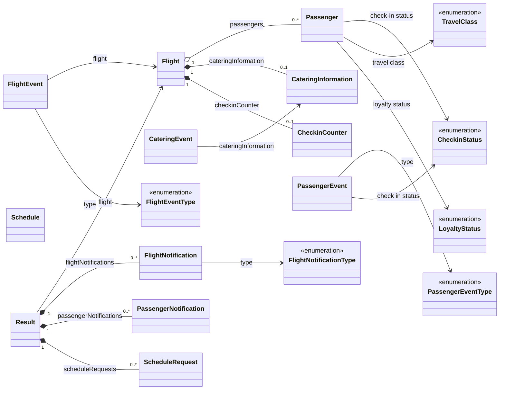

# Airline Decision Service – Ontology

This document describes the **business object model** (BOM) of the `AirlineDataModel` project: the concepts, their properties, their relationships and the helper functions that the rules use.

Related documents:
- [Event processing](event-processing.md) – how the rules consume and produce these concepts
- [Situations](situations.md) – the situations detected by the rule logic

Source files: `AirlineDecisionService/AirlineDataModel/bom/model.bom`, `bom/model_en_US.voc` (business vocabulary) and `functions/data-processing.code` (function bodies).

---

## 1. Overview

The model describes a simplified airline operation. A [Flight](#flight) carries [Passengers](#passenger), catering stock and a check-in tally. The outside world sends **events** about flights, passengers, catering and schedules. The rules react to those events, update the flight, and answer with a [Result](#result) holding notifications and follow-up schedule requests.

### 1.1 Concept map

Solid-line associations without a class box on the far end are typed attributes. Events and notifications that only share a `flightNumber` or `passengerId` string with a [Flight](#flight) or [Passenger](#passenger) are **logical references** (no object link) – see [section 4](#4-logical-references-by-key).

### 1.2 Concept index

| Category | Concepts |
|---|---|
| Core entities | [Flight](#flight), [Passenger](#passenger) |
| Value objects (owned by a flight) | [CateringInformation](#cateringinformation), [CheckinCounter](#checkincounter) |
| Incoming events | [FlightEvent](#flightevent), [PassengerEvent](#passengerevent), [CateringEvent](#cateringevent), [Schedule](#schedule) |
| Outgoing results | [Result](#result), [FlightNotification](#flightnotification), [PassengerNotification](#passengernotification), [ScheduleRequest](#schedulerequest) |
| Enumerations | [FlightEventType](#flighteventtype), [PassengerEventType](#passengereventtype), [FlightNotificationType](#flightnotificationtype), [CheckinStatus](#checkinstatus), [TravelClass](#travelclass), [LoyaltyStatus](#loyaltystatus) |
| Functions | [Functions](#5-functions) |

All concepts live in the Java package `diadmin.airline.airlinedecisionservice.airlinedatamodel`. In the property tables, the *Verbalization* column is the phrase used in rules (from `model_en_US.voc`).

---

## 2. Entities and value objects

### Flight

**Business label:** Flight · **Kind:** entity (the state that rules maintain)

A scheduled flight with its aircraft, route, passenger list, catering stock, check-in tally and meal-shortage state. A flight is identified by its `flightNumber`.

| Property | Verbalization | Type | Meaning |
|---|---|---|---|
| `flightNumber` | flight number | string | Identifier of the flight. |
| `aircraftId` | aircraft id | string | Tail/identifier of the aircraft. |
| `aircraftType` | aircraft type | string | Aircraft model. |
| `origin` | origin | string | Departure airport. |
| `destination` | destination | string | Arrival airport. |
| `date` | date | ZonedDateTime | Scheduled departure date and time. |
| `expectedDate` | expected date | ZonedDateTime | Currently expected departure; updated when the flight is delayed. |
| `duration` | duration | CalendarDuration | Planned flight duration. |
| `passengers` | passenger | List of [Passenger](#passenger) (0..*) | Passengers booked on the flight. |
| `cateringInformation` | catering information | [CateringInformation](#cateringinformation) | Meals loaded on board per travel class. |
| `checkinCounter` | checkin counter | [CheckinCounter](#checkincounter) | Running number of checked-in passengers per travel class. |
| `shortMealSituation` | is in short meal situation | boolean | `true` while a [meal shortage](situations.md#3-meal-shortage) is open. |
| `shortMealSituationStartDate` | short meal situation start date | ZonedDateTime | When the current/last shortage was detected. |
| `shortMealSituationEndDate` | short meal situation end date | ZonedDateTime | When the last shortage was cleared. |

**Relationships**
- contains 0..* [Passenger](#passenger)
- owns one [CateringInformation](#cateringinformation) and one [CheckinCounter](#checkincounter) (both optional; created on demand by [ValidateFlight](#validateflight) and [CheckPassengerIn](#checkpassengerin))
- is embedded in a [FlightEvent](#flightevent) (`flight`) and returned by a [Result](#result) (`flight`)
- is the subject of [FlightNotification](#flightnotification) and [PassengerNotification](#passengernotification) through `flightNumber`

**Collection operations:** add, remove, clear and set the `passengers` list.

---

### Passenger

**Business label:** Passenger · **Kind:** entity (member of a [Flight](#flight))

A person booked on a flight.

| Property | Verbalization | Type | Meaning |
|---|---|---|---|
| `passengerId` | passenger id | string | Identifier, unique within the flight; used to match a [PassengerEvent](#passengerevent). |
| `name` | name | string | Passenger name. |
| `birthdate` | birthdate | ZonedDateTime | Date of birth. |
| `citizenship` | citizenship | string | Country of citizenship. |
| `residenceCountry` | residence country | string | Country of residence. |
| `loyaltyStatus` | loyalty status | [LoyaltyStatus](#loyaltystatus) | Frequent-flyer tier. |
| `travelClass` | travel class | [TravelClass](#travelclass) | Cabin booked. |
| `check$inStatus` | check-in status | [CheckinStatus](#checkinstatus) | Current check-in state. |
| `requireSpecialMeal` | is require special meal | boolean | Whether the passenger needs a special meal. |

**Relationships**
- belongs to one [Flight](#flight) (through `Flight.passengers`)
- typed by [LoyaltyStatus](#loyaltystatus), [TravelClass](#travelclass), [CheckinStatus](#checkinstatus)
- targeted by [PassengerEvent](#passengerevent) (`passengerId`) and [PassengerNotification](#passengernotification) (`passengerNumber`)
- described by [PassengerAsString](#passengerasstring)

---

### CateringInformation

**Business label:** Catering Information · **Kind:** value object

The number of meals loaded on a flight, per travel class.

| Property | Verbalization | Type | Meaning |
|---|---|---|---|
| `economyTotalMealCount` | economy total meal count | int | Meals available in Economy. |
| `businessTotalMealCount` | business total meal count | int | Meals available in Business. |
| `firstTotalMealCount` | first total meal count | int | Meals available in First. |

**Relationships**
- owned by a [Flight](#flight); carried by a [CateringEvent](#cateringevent)
- compared with [CheckinCounter](#checkincounter) by [CateringIsGood](#cateringisgood)
- summarized by [CateringInformationReport](#cateringinformationreport)

---

### CheckinCounter

**Business label:** Checkin Counter · **Kind:** value object

How many passengers are currently checked in on a flight, per travel class. Stored as `double`.

| Property | Verbalization | Type | Meaning |
|---|---|---|---|
| `economyCheckinCounter` | economy checkin counter | double | Checked-in Economy passengers. |
| `businessCheckinCounter` | business checkin counter | double | Checked-in Business passengers. |
| `firstCheckinCounter` | first checkin counter | double | Checked-in First passengers. |

**Relationships**
- owned by a [Flight](#flight)
- incremented by [CheckPassengerIn](#checkpassengerin), decremented by [CancelPassengerCheckIn](#cancelpassengercheckin)
- compared with [CateringInformation](#cateringinformation) by [CateringIsGood](#cateringisgood)

---

## 3. Events, results and enumerations

### Incoming events

#### FlightEvent

**Business label:** Flight Event · **Kind:** event (timestamped)

Something happened to a flight.

| Property | Verbalization | Type | Meaning |
|---|---|---|---|
| `timestamp` | timestamp | ZonedDateTime | When the event occurred. |
| `flightNumber` | flight number | string | Flight concerned. |
| `type` | type | [FlightEventType](#flighteventtype) | Kind of event. |
| `flight` | flight | [Flight](#flight) | Snapshot of the flight carried by the event (notably the new `expectedDate` for a delay, or the full flight for an opening). |

Processed by the [Process Flight Event](event-processing.md#31-process-flight-event-processflightevent) operation.

#### PassengerEvent

**Business label:** Passenger Event · **Kind:** event (timestamped)

Something happened to a passenger of a flight (check-in, cancellation of check-in, no-show).

| Property | Verbalization | Type | Meaning |
|---|---|---|---|
| `timestamp` | timestamp | ZonedDateTime | When the event occurred. |
| `flightNumber` | flight number | string | Flight concerned. |
| `passengerId` | passenger id | string | Matches [Passenger.passengerId](#passenger). |
| `type` | type | [PassengerEventType](#passengereventtype) | Kind of event. |
| `checkInStatus` | check in status | [CheckinStatus](#checkinstatus) | Status reported with the event. |

Processed by [Process Passenger Event](event-processing.md#33-process-passenger-event-processpassengerevent).

#### CateringEvent

**Business label:** Catering Event · **Kind:** event (timestamped)

The catering stock of a flight was reported or changed.

| Property | Verbalization | Type | Meaning |
|---|---|---|---|
| `timestamp` | timestamp | ZonedDateTime | When the event occurred. |
| `flightNumber` | flight number | string | Flight concerned. |
| `cateringInformation` | catering information | [CateringInformation](#cateringinformation) | New meal counts. |

Processed by [Process Catering Event](event-processing.md#32-process-catering-event-processcateringevent).

#### Schedule

**Business label:** Schedule · **Kind:** timer event

A timer that fired. It is the answer to a [ScheduleRequest](#schedulerequest) emitted earlier.

| Property | Verbalization | Type | Meaning |
|---|---|---|---|
| `id` | id | string | Which schedule fired, e.g. `CHECK-IN-OPEN`. |
| `description` | description | string | Free text. |
| `timestamp` | timestamp | string | Time of the trigger (stored as text, unlike other events). |

Processed by [Process Schedule Event](event-processing.md#34-process-schedule-event-processschedule).

---

### Outgoing results

#### Result

**Business label:** Result · **Kind:** output container

What a rule operation returns. Created at the start of every operation with `flight` set to the current flight.

| Property | Verbalization | Type | Meaning |
|---|---|---|---|
| `flight` | flight | [Flight](#flight) | The flight after rules have updated it. |
| `flightNotifications` | flight notification | List of [FlightNotification](#flightnotification) | Messages about the flight as a whole. |
| `passengerNotifications` | passenger notification | List of [PassengerNotification](#passengernotification) | Messages for individual passengers. |
| `scheduleRequests` | schedule request | List of [ScheduleRequest](#schedulerequest) | Timers the platform is asked to start. |

Collection operations (add, remove, clear, set) exist for each list.

#### FlightNotification

**Business label:** Flight Notification · **Kind:** notification (timestamped)

A message about a flight (delay, meal shortage, check-in open, warning).

| Property | Verbalization | Type | Meaning |
|---|---|---|---|
| `timestamp` | timestamp | ZonedDateTime | When it was raised (`now`). |
| `flightNumber` | flight number | string | Flight concerned. |
| `type` | type | [FlightNotificationType](#flightnotificationtype) | Category. |
| `message` | message | string | Human-readable text. |

#### PassengerNotification

**Business label:** Passenger Notification · **Kind:** notification (timestamped)

A message addressed to one passenger.

| Property | Verbalization | Type | Meaning |
|---|---|---|---|
| `timestamp` | timestamp | ZonedDateTime | When it was raised. |
| `flightNumber` | flight number | string | Flight concerned. |
| `passengerNumber` | passenger number | string | Holds the [Passenger.passengerId](#passenger). |
| `message` | message | string | Human-readable text. |

#### ScheduleRequest

**Business label:** Schedule Request · **Kind:** timer request

Asks the platform to call back at a given time with a matching [Schedule](#schedule).

| Property | Verbalization | Type | Meaning |
|---|---|---|---|
| `id` | id | string | Timer name (e.g. `CHECK-IN-OPEN`); comes back as `Schedule.id`. |
| `description` | description | string | Free text. |
| `status` | status | string | Timer action, e.g. `START`. |
| `timepoint` | timepoint | ZonedDateTime | When the callback is due. |

---

### Enumerations

#### FlightEventType

Kind of [FlightEvent](#flightevent). Values: `FLIGHT OPEN`, `FLIGHT DELAYED`, `FLIGHT CANCELLED`, `FLIGHT CLOSE`, `FLIGHT INFO`, `PASSENGER ADDED`, `PASSENGER MODIFIED`, `PASSENGER REMOVED`.
Rules currently react to `FLIGHT OPEN` and `FLIGHT DELAYED` only.

#### PassengerEventType

Kind of [PassengerEvent](#passengerevent). Values: `CHECK IN`, `CANCEL CHECK IN`, `NO SHOW`.
Rules currently react to `CHECK IN` and `CANCEL CHECK IN` only.

#### FlightNotificationType

Category of a [FlightNotification](#flightnotification). Values: `Cancelled`, `Check In Open`, `Closed`, `Delayed`, `Information`, `Meal Shortage`, `Meal Shortage Cleared`.
Rules currently emit `Check In Open`, `Information`, `Meal Shortage` and `Meal Shortage Cleared`.

#### CheckinStatus

Check-in state of a [Passenger](#passenger) (also reported by a [PassengerEvent](#passengerevent)). Values: `Pending`, `Checked In`, `Cancelled`.

#### TravelClass

Cabin of a [Passenger](#passenger). Values: `Economy`, `Business`, `First`. Selects which counter of [CheckinCounter](#checkincounter) is changed.

#### LoyaltyStatus

Frequent-flyer tier of a [Passenger](#passenger). Values: `Silver`, `Gold`, `Platinum`. Not used by any current rule.

---

## 4. Logical references by key

Some concepts point to others by value, not by object link:

| From | Property | Refers to |
|---|---|---|
| [PassengerEvent](#passengerevent) | `flightNumber` | [Flight.flightNumber](#flight) |
| [PassengerEvent](#passengerevent) | `passengerId` | [Passenger.passengerId](#passenger) (looked up in `Flight.passengers`) |
| [CateringEvent](#cateringevent) | `flightNumber` | [Flight.flightNumber](#flight) |
| [FlightEvent](#flightevent) | `flightNumber` | [Flight.flightNumber](#flight) (in addition to the embedded `flight`) |
| [FlightNotification](#flightnotification) | `flightNumber` | [Flight.flightNumber](#flight) |
| [PassengerNotification](#passengernotification) | `flightNumber`, `passengerNumber` | [Flight.flightNumber](#flight), [Passenger.passengerId](#passenger) |
| [ScheduleRequest](#schedulerequest) → [Schedule](#schedule) | `id` | Same value links the request to the callback. |

---

## 5. Functions

Functions are defined on the hidden class `Functions` (`...airlinedatamodel.internal`). The rules call them through the verbalizations shown. "Pure" functions only compute a value; the others change the objects passed in.

### Summary

| Function | Rule phrase | Pure | Purpose |
|---|---|---|---|
| [CheckPassengerIn](#checkpassengerin) | check in *the passenger* on *the flight* | no | Mark checked in and count. |
| [CancelPassengerCheckIn](#cancelpassengercheckin) | cancel *the passenger* check-in on *the flight* | no | Mark cancelled and uncount. |
| [CateringIsGood](#cateringisgood) | the catering situation for *the flight* is good | yes | Is there enough food? |
| [CateringInformationReport](#cateringinformationreport) | the report of *the catering information* | yes | Meal counts as text. |
| [PassengerInformationOfTheFlight](#passengerinformationoftheflight) | the passenger information of *the flight* | yes | Passenger counts as text. |
| [PassengerAsString](#passengerasstring) | *the passenger* as text | yes | One-line passenger description. |
| [ValidateFlight](#validateflight) | the validated flight from *the flight* | yes | Fill in missing sub-objects. |
| [Percentage](#percentage) | *p*% of *v* | yes | Compute a percentage. |
| [TimePeriodBeforeDate](#timeperiodbeforedate) | *period* before *date* | yes | Subtract a duration. |
| [TimePeriodAfterDate](#timeperiodafterdate) | *period* after *date* | yes | Add a duration. |

### CheckPassengerIn

*Signature:* `CheckPassengerIn(`[Passenger](#passenger)`, `[Flight](#flight)`)` – verbalized as **check in {the passenger} on {the flight}**.

Plain English: marks the passenger as **Checked In**, then updates the flight's tally. If the flight has no [CheckinCounter](#checkincounter) yet, it creates an empty one. Depending on the passenger's [TravelClass](#travelclass) it adds **1** to the Economy, Business or First counter.

Used by: [Passenger Check-In](event-processing.md#rules-passenger-event), [Initialize Checkin Status](event-processing.md#rules-flight-event).

### CancelPassengerCheckIn

*Signature:* `CancelPassengerCheckIn(`[Passenger](#passenger)`, `[Flight](#flight)`)` – verbalized as **cancel {the passenger} check-in on {the flight}**.

Plain English: marks the passenger as **Cancelled**, creates the [CheckinCounter](#checkincounter) if missing, and **subtracts 1** from the counter matching the passenger's [TravelClass](#travelclass).

The function does not check that the passenger was actually checked in beforehand, so cancelling a passenger who was not counted would drive the counter below the true value.

Used by: [Passenger Cancel Check-In](event-processing.md#rules-passenger-event).

### CateringIsGood

*Signature:* `CateringIsGood(`[Flight](#flight)`)` → boolean – verbalized as **the catering situation for {the flight} is good**.

Plain English: starts by assuming the catering is fine. It becomes **not good** as soon as one cabin is nearly out of meals:

| Cabin | Not good when checked-in passengers exceed |
|---|---|
| Economy | 95 % of the economy meal count |
| Business | 90 % of the business meal count |
| First | 85 % of the first meal count |

The comparison uses [CheckinCounter](#checkincounter) against [CateringInformation](#cateringinformation) and the [Percentage](#percentage) function.

Used by the [meal-shortage](situations.md#3-meal-shortage) detection and clearing rules.

### CateringInformationReport

*Signature:* `CateringInformationReport(`[CateringInformation](#cateringinformation)`)` → string – verbalized as **the report of {the catering information}**.

Plain English: writes the meal counts as text, e.g. `[ Economy meals: 150, Business meals: 20, First meals: 8 ]`.

### PassengerInformationOfTheFlight

*Signature:* `PassengerInformationOfTheFlight(`[Flight](#flight)`)` → string – verbalized as **the passenger information of {the flight}**.

Plain English: counts the passengers on the flight and, among those with status **Checked In**, how many are in Economy, Business and First. Returns a sentence like `Total passenger count: 180 ( (passengers checked-in: Economy: 120, Business: 15, First: 6)`. The opening parenthesis of the text is not closed in the source definition.

### PassengerAsString

*Signature:* `PassengerAsString(`[Passenger](#passenger)`)` → string – verbalized as **{the passenger} as text**.

Plain English: returns one line `Passenger <id>: <name> [<travel class>]`.

### ValidateFlight

*Signature:* `ValidateFlight(`[Flight](#flight)`)` → [Flight](#flight) – verbalized as **the validated flight from {the flight}**.

Plain English: makes sure a flight is usable. If it has no [CheckinCounter](#checkincounter) or no [CateringInformation](#cateringinformation), an empty one is created. Returns the same flight.

Used by: [Flight Initialization Rule](event-processing.md#rules-flight-event).

### Percentage

*Signature:* `Percentage(double percentage, double value)` → double – verbalized as **{percentage}% of {value}**.

Plain English: returns `percentage / 100 × value`, e.g. 95% of 200 is 190.

### TimePeriodBeforeDate

*Signature:* `TimePeriodBeforeDate(CalendarDuration, ZonedDateTime)` → ZonedDateTime – verbalized as **{time period} before {date}**.

Plain English: the date moved earlier by the given duration. Example: 48 hours before the [Flight](#flight) `date`.

### TimePeriodAfterDate

*Signature:* `TimePeriodAfterDate(CalendarDuration, ZonedDateTime)` → ZonedDateTime – verbalized as **{time period} after {date}**.

Plain English: the date moved later by the given duration.
