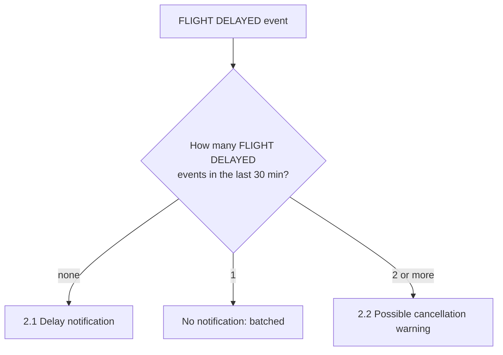
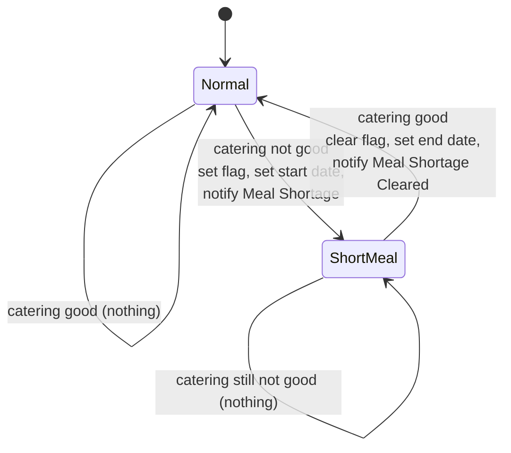
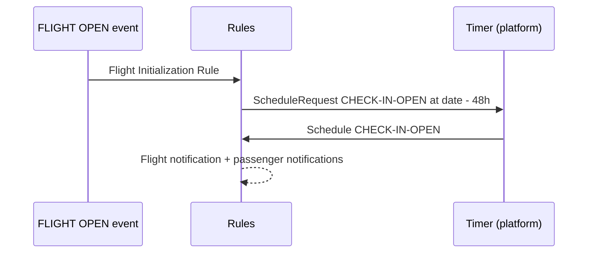

# Airline Decision Service – Situations

A **situation** is a business condition the rules recognize from a combination of events and flight state. This document lists each situation, how it is detected and what is raised.

Related documents:
- [Event processing](event-processing.md) – the operations and rule flows
- [Ontology](ontology.md) – concepts and functions

---

## 1. Summary

| # | Situation | Detected on event | Output | Rules |
|---|---|---|---|---|
| 2.1 | [Flight delay (first notification)](#21-flight-delay-first-notification) | [FlightEvent](ontology.md#flightevent) `FLIGHT DELAYED` | [FlightNotification](ontology.md#flightnotification) | Flight Delayed Notification Rule |
| 2.2 | [Possible flight cancellation](#22-possible-flight-cancellation-burst-of-delays) | [FlightEvent](ontology.md#flightevent) `FLIGHT DELAYED` | [FlightNotification](ontology.md#flightnotification) `Information` | Detect Flight Possible Cancellation |
| 3 | [Meal shortage](#3-meal-shortage) (open and cleared) | [PassengerEvent](ontology.md#passengerevent) check-in / cancel, [CateringEvent](ontology.md#cateringevent) | [FlightNotification](ontology.md#flightnotification) `Meal Shortage` / `Meal Shortage Cleared`, flag on [Flight](ontology.md#flight) | 4 rules |
| 4 | [Early check-in attempt](#4-early-check-in-attempt) | [PassengerEvent](ontology.md#passengerevent) `CHECK IN` | [FlightNotification](ontology.md#flightnotification) `Information` | Early Passenger Check-In |
| 5 | [Check-in opening](#5-check-in-opening) | [Schedule](ontology.md#schedule) `CHECK-IN-OPEN` | [FlightNotification](ontology.md#flightnotification) `Check In Open` + [PassengerNotification](ontology.md#passengernotification) per passenger | Check-In Open Rule, Check-In Open Notify Passengers |

Only the meal shortage is **stateful**: it is stored on the [Flight](ontology.md#flight) so it is raised once and cleared once. The others are derived from the current event, the clock and the supplied event history.

---

## 2. Delay situations

Both are evaluated by [Process Flight Event](event-processing.md#31-process-flight-event-processflightevent). Alongside them, the *Flight Delayed Rule* stores the new `expectedDate` on the [Flight](ontology.md#flight), but it does not itself raise a situation.

### 2.1 Flight delay (first notification)

**Rule:** Flight Delayed Notification Rule

**Detected when**
1. the event is a `FLIGHT DELAYED` [FlightEvent](ontology.md#flightevent), **and**
2. there is no other `FLIGHT DELAYED` event within the 30 minutes before *now* in the past flight events.

**Raised:** a [FlightNotification](ontology.md#flightnotification) “Flight as being delayed. new expected time: *expected date*”, for the event's flight number.

**Purpose:** tell people about a delay once, then **batch** further delay events in the following 30 minutes to avoid a flood of messages.

Observation: the rule does not set the notification `type`, so it is left empty. The `Delayed` value of [FlightNotificationType](ontology.md#flightnotificationtype) is not used by any rule.

### 2.2 Possible flight cancellation (burst of delays)

**Rule:** Detect Flight Possible Cancellation

**Detected when**
1. the event is a `FLIGHT DELAYED` [FlightEvent](ontology.md#flightevent), **and**
2. at least **2** `FLIGHT DELAYED` events exist in the past flight events during the 30 minutes before *now*.

**Raised:** a [FlightNotification](ontology.md#flightnotification) of type `Information`, message “Burst of Delay Event indicating a potential flight cancellation”, plus a log line.

**Purpose:** repeated delay updates in a short time suggest the flight may be cancelled, so operations are warned early.

The diagram assumes the list of past events does not include the current event. The rules do not exclude it explicitly.

---

## 3. Meal shortage

Meal shortage means the checked-in passengers have used up almost all meals loaded on the flight.

### 3.1 How “not enough meals” is decided

Decision function: [CateringIsGood](ontology.md#cateringisgood), which compares the [CheckinCounter](ontology.md#checkincounter) with the [CateringInformation](ontology.md#cateringinformation) of the [Flight](ontology.md#flight).

| Cabin | Catering is **not good** when checked-in passengers are more than |
|---|---|
| Economy | 95 % of meals |
| Business | 90 % of meals |
| First | 85 % of meals |

Catering is good only if all three cabins are at or below their thresholds.

### 3.2 State machine

The state is the boolean `shortMealSituation` on the [Flight](ontology.md#flight), with `shortMealSituationStartDate` and `shortMealSituationEndDate`.

Because the flag is checked first, a shortage is announced **once** and cleared **once**, not on every event.

### 3.3 Triggers and rules

Evaluated whenever the data it depends on may have changed: after a passenger check-in or cancellation, and after a catering update.

| Trigger | Rule | Condition | Effect |
|---|---|---|---|
| Passenger event | **Detect Meal Shortage Situation** | `CHECK IN` or `CANCEL CHECK IN`; not in short meal situation; catering not good | Set flag, set start date to *now*, add `Meal Shortage` notification: “Meal shortage situation. Available meals: …, Passenger information: …” |
| Passenger event | **Meal Shortage Situation Cleared** | `CHECK IN` or `CANCEL CHECK IN`; in short meal situation; catering good | Clear flag, set end date to *now*, add `Meal Shortage Cleared` notification: “Meal shortage situation is cleared: …” |
| Catering event | **Detect Short Meal Situation** | not in short meal situation; catering not good | Same as *Detect Meal Shortage Situation* |
| Catering event | **Short Meal Situation Cleared** | in short meal situation; catering good | Same as *Meal Shortage Situation Cleared*, with the shorter message “Meal shortage situation is cleared” |

Notification content uses [CateringInformationReport](ontology.md#cateringinformationreport) and [PassengerInformationOfTheFlight](ontology.md#passengerinformationoftheflight).

Typical scenarios:
- **Check-ins drive the count up:** the 96th Economy passenger checks in on a flight with 100 Economy meals → shortage raised.
- **A cancellation brings the count down:** a check-in cancellation brings the count back under the limit → shortage cleared.
- **More meals are loaded:** a [CateringEvent](ontology.md#cateringevent) with higher meal counts → shortage cleared.
- **Fewer meals are reported:** a [CateringEvent](ontology.md#cateringevent) with lower meal counts → shortage raised.

---

## 4. Early check-in attempt

**Rule:** Early Passenger Check-In (in [Process Passenger Event](event-processing.md#33-process-passenger-event-processpassengerevent))

**Detected when** a `CHECK IN` [PassengerEvent](ontology.md#passengerevent) occurs **more than 48 hours before** the flight, i.e. before check-in is open.

**Raised:** a [FlightNotification](ontology.md#flightnotification) of type `Information`: “Warning: Passenger *name* checked-in at *now*, before check-in is open”.

**Effect on state:** none. The companion rule *Passenger Check-In* only acts on check-ins made inside the 48-hour window, so an early check-in is reported but not counted.

---

## 5. Check-in opening

This is a **time-based** situation, set up in two steps:

1. When the flight is opened (`FLIGHT OPEN`), [Flight Initialization Rule](event-processing.md#rules-flight-event) adds a [ScheduleRequest](ontology.md#schedulerequest) `CHECK-IN-OPEN` due 48 hours before departure.
2. When the platform returns the matching [Schedule](ontology.md#schedule) (`id` = `CHECK-IN-OPEN`), [Process Schedule Event](event-processing.md#34-process-schedule-event-processschedule) raises:
   - **Check-In Open Rule:** one [FlightNotification](ontology.md#flightnotification) of type `Check In Open`.
   - **Check-In Open Notify Passengers:** one [PassengerNotification](ontology.md#passengernotification) per passenger on the flight, inviting them to check in online.

This 48-hour threshold is the same one the passenger rules use to decide whether a check-in is early ([section 4](#4-early-check-in-attempt)).
